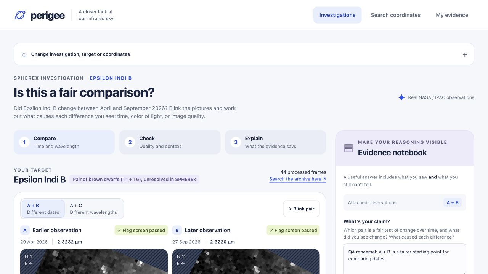

# Cloudflare public release verification

Verified on 2026-11-15, approximately 01:14–01:18 UTC, without authentication.

- App: https://perigee.lokesathvik.workers.dev
- PDF: https://perigee.lokesathvik.workers.dev/demo/perigee-demo.pdf
- Worker version: `979e0619-e17e-4471-bce1-1144129f7a33`
- Deployed source: `fd7933d85ea518aa11fb34918c8d6fbe1de9e6a5`
- Catalog content: `targets-2026-11-15a`, including the WISE 0855 source correction.
- PDF: 7 pages, 2,369,713 bytes, SHA-256 `ffab44ce1f9fe182d2b9f427ae186c30e18e2cfc7ff6ea24099ecbd8d05ca89e`.

## Automated checks

The final bundle passed `npm run build`, 7 Python export-parity tests, 15 Worker tests and Wrangler dry-run before deployment. The export contains five presets, two cases, two case-specific frame sets and 952 asset IDs (574 canonical files and 378 aliases). Every exported asset was compared byte-for-byte with the Python catalog.

The deployed [release smoke](release-smoke.txt) passed **20/20**: public access, SPA routes, health, catalog, PNG decoding, JSON errors, live Orion search (377 matches, 1.8 s) and one processed frame (valid 10,642-byte PNG, 3.5 s). Timings describe this run only. Search, frame and health use the existing Vercel Python API through the fixed-origin proxy.

The first static/route smoke was **21/23** ([original output](initial-static-smoke.txt)). Both differences were traced to Cloudflare's edge, not changed data:

- Compressed JSON receives a weak ETag (`W/` prefix). The decompressed content still matches its SHA-256 exactly; an identity-encoded request preserves the strong ETag. This matches [Cloudflare's ETag behavior](https://developers.cloudflare.com/cache/reference/etag-headers/).
- The exact path `/api/v1/assets/x%00.png` is rejected by Cloudflare with HTTP 400 HTML before the Worker runs. The response has `server: cloudflare` and no application request ID. This exception applies only to that malformed-path probe; normal unknown API routes and traversal probes still produce JSON 404s.

The smoke harness now has an explicit `--cloudflare-edge` mode for these narrow expectations. The deployed run passed **24/24**, including the encoded-NUL rejection as its own check, exact PDF and JS bytes, all ten catalog documents, three asset types, remaining route parity and blocked internal manifest paths. Local Worker tests retain the original FastAPI expectations. No production code was changed to make these checks pass.

Reproduce after building and generating route expectations as described in [CLOUDFLARE.md](../../docs/CLOUDFLARE.md):

```sh
python cloudflare/tests/smoke_local.py --base https://perigee.lokesathvik.workers.dev --cloudflare-edge
python -m backend.platform.smoke --base https://perigee.lokesathvik.workers.dev
```

## Browser check

A fresh Cloudflare browser origin had no saved notes. The following were checked in the in-app browser:

- Open Epsilon Indi B and load the actual A/B images.
- Switch to A/C; dates/wavelength labels and explanation update.
- Turn on flagged pixels; overlays and legend appear.
- Write synthetic QA notes, return home, reopen the saved card; all three fields restore and the app says “Restored from this device”.
- Download [the actual JSON evidence card](evidence-card.json), containing A/B frame provenance and the entered claim, observations and uncertainty.
- All three visible science images report loaded; no console errors were recorded.



This was a hosting migration check, not a repeat of every earlier accessibility or science check. The earlier [production journey](../production-journey/README.md) retains that evidence. Physical-phone and screen-reader tests remain unperformed.

Cloudflare serves the frontend and curated content independently of the live archive/API. Live searches still depend on Vercel and IRSA. Browser notes on the old Vercel origin do not migrate to Cloudflare automatically. Nothing has been submitted to the competition.
