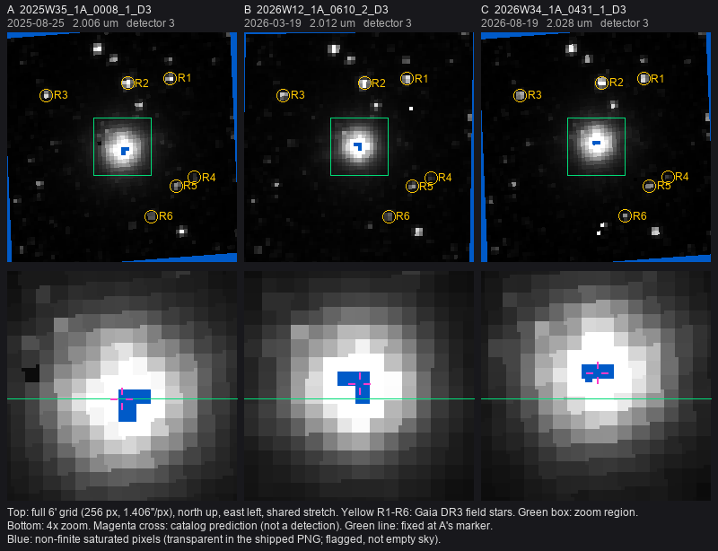

# Barnard's Star `moving_neighbor` case review

Reviewer: parallel worker 10, 2026-11-14. This is a review only. No processor code or products were changed. The proposed text changes are in a separate commit to `backend/content/cases/moving_neighbor.json` for Sathvik to accept or reject.

**Verdict: PASS, with display conditions.** The shipped imagery supports the intended visual demonstration:
- **The star:** Barnard's Star's glow shifts north by about 7 display px from A to C.
- **The field stars:** they stay put to within under 1 display px.

The case needs three conditions:
- the text correction below
- a fixed guide line
- a visible flag legend, so that the saturated core does not read as a dark hole

No frame change is recommended.

| Ref | frame_key | Release | Mid-exposure UTC | λ at marker | Marker (x, y) display px |
|---|---|---|---|---|---|
| A | `2025W35_1A_0008_1_D3` | DR1 | 2025-08-25 00:50:31.845 | 2.006 µm | 127.80, 130.61 |
| B | `2026W12_1A_0610_2_D3` | DR1 | 2026-03-19 09:06:02.748 | 2.012 µm | 128.12, 126.43 |
| C | `2026W34_1A_0431_1_D3` | QR3 | 2026-08-19 04:57:42.053 | 2.028 µm | 128.36, 123.34 |

**Grid and stretch:**
- **Grid:** `f2860f77053de67b`, 256 px over 6′, so **1.40625″ per display px**. The native SPHEREx pixel is 6.15″, which is 4.4 display px.
- **Stretch:** one shared asinh stretch, 0.170–32.7 MJy/sr.
- **Time baseline:** A→B 0.565 yr, A→C 0.983 yr.



`contact_sheet.png` has two rows:
- **Top row:** the full shipped grids. R1–R6 are Gaia DR3 field stars.
- **Bottom row:** a 4× zoom. The magenta cross is the catalog prediction, and the green line is fixed at A's marker.

Blue marks pixels that are transparent in the shipped PNG (non-finite, saturated).

## Findings

### 1. Marker motion: the case text is wrong by a factor of about 3.5

The case currently says the marker moves "about 2 display pixels at 5 arcsec/pixel". That figure came from the earlier 5″ audit grid. The shipped grid is 1.406″/px.

For an independent check, I re-derived the marker in two ways:
- **SIMBAD J2000 astrometry:** propagated with astropy `apply_space_motion` to each frame's `MJD-AVG`, read from the raw IMAGE header.
- **Projection:** a hand-written gnomonic grid, north up and east left, centered on the preset `query_center`.

| | dx (px, + = west) | dy (px, − = north) | distance |
|---|---|---|---|
| Marker A→B | +0.32 | −4.18 | **4.19 px = 5.9″** |
| Marker A→C | +0.56 | −7.27 | **7.29 px = 10.25″** (1.67 SPHEREx px) |

Two cross-checks agree with these values:
- **Processor A's `marker.x/y`:** it agrees with this derivation to within 0.0007 px across all 34 frames.
- **Barnard's Star's own Gaia DR3 row:** propagated linearly, it agrees to within 0.32 px.

The A→C value matches the acceptance review (4.19 / 7.29 px). The slight westward drift is consistent with the negative pmRA.

Annual parallax is not modeled. A and C are both late-August epochs, so parallax nearly cancels between them. B (March) can differ by up to about 0.5″, which is about 0.4 display px.

### 2. Surrounding sources are stable

- **Absolute check against Gaia DR3, all 34 frames:**
  - 6–10 Gaia DR3 field stars per frame were centroided in the native image and mapped to the grid through the raw header TAN-SIP WCS.
  - The per-frame median offset from Gaia is **≤ 0.29 display px**. The per-star scatter is 1.0–1.3 px rms, which is centroid noise on 6.15″ native pixels.
- **On the case PNGs (what the learner sees):**
  - Six unblended field stars (R1–R6, G = 11.9–14.8) were centroided in A, B and C.
  - Median shift A→B is (−0.21, +0.23) px, and A→C is (−0.16, −0.12) px. No component exceeds **0.77 px**.
  - Barnard's Star moves about 7 px, roughly 10× the largest field-star jitter.

Conclusion: the frames are registered on a common sky grid. The field stars give the learner an honest fixed reference. This is positional only. No photometry was done or is implied.

### 3. Prediction versus what the image shows

- **The marker is a catalog prediction.** It is not measured from these images.
- **The image shows a glow that moves north.** As a *visual proxy*, I took the intensity-weighted center of the glow, counting saturated, non-finite pixels as white:

  | Method | A→B | A→C |
  |---|---|---|
  | Published PNG, 15 px window | 4.19 px | 7.20 px |
  | Native image mapped to grid, r = 4 native px | 4.53 px | 6.87 px |
  | Acceptance review, 14 px PNG window | 3.2 px | 6.6 px |

  The answer depends on the method by about 1 px.
- **The proxy is not astrometry.** Across all 34 frames, the proxy differs from the marker by a median (−0.05, +0.24) px, with a scatter of 1.0 px (x) and 0.4 px (y). The worst single frame is 2.7 px off. The core is saturated, so no centroid or proper-motion value is supported.
- **What the evidence supports is qualitative:** "the glow shifts north by about the predicted amount", not a number.

### 4. Bright-source flags and the transparent core

Every case frame is flagged at the star:
- **Aperture:** all screened pixels are adverse (19/19, 20/20 and 19/19), with flags BLOOM, OVERFLOW, SUR_ERROR and TRANSIENT, plus NONFUNC in B.
- **Native core:** 2–3 non-finite pixels within 3 native px.
- **PNG:** the core renders **transparent**, with 61, 56 and 38 transparent display px within 10 px of the marker. The hole also changes shape between frames.

On a dark page this reads as a black hole in the star. It invites two false readings: "the star is dark in the middle" and "the hole shrank, so it changed".

The teaching task stays honest, because it asks only for direction and rough size relative to fixed stars and the marker. Both are visible in the halo and in the position of the hole. For that to hold, the UI must show:
- **Flag legend:** the flag legend and status visible by default for these frames. Read the colors from `flag_image.legend` (processor A: red = adverse, yellow = non-finite).
- **Saturated core:** either the overlay on by default, or the non-finite core painted in a distinct, labeled color, never page-black.
- **Hint copy:** text saying the patch is "saturated, no usable value" (added to the flags step and to `not_supported`).

The frontend team has already been told about the transparent-core issue (acceptance escalation 3).

### 5. Demonstration value and alternative frames

- **At full-grid view the shift is subtle but real.** The shifts are about 7 px, and the saturated glow is about 40 display px across under this stretch. Blinking with a **fixed guide line** makes it clear: in the zoom row, the core sits below the line in A and above it in C. Without the line, a learner may miss it. The proposal therefore makes the guide line *required*.
- **A longer baseline would barely help.** The longest available baseline is 2025-08-16 to 2026-08-25, giving 7.58 px against 7.29 px now (+4%).
- **A D5 trio was considered and rejected.** The 3.85 µm D5 frames `2025W34_2B_0557_1_D5`, `2026W11_2A_0513_1_D5` and `2026W34_2A_0178_3_D5` have **no non-finite core**, so there is no transparent hole, and they show a 7.32 px marker shift. They are still flagged (OVERFLOW/BLOOM), though. Their B frame is 0.086 µm from A, more than one bandwidth (0.035 µm). The processor's shared-stretch rule (`tools/ingest/ingest.py: shared_groups_for_case`) would therefore give B its own stretch and break the blink comparison. Not recommended.
- **Recommendation:** keep the current D3 trio. No regeneration is needed.

## Learner question (proposed)

> Barnard's Star moves across our sky faster than any other known star. Blink SPHEREx images taken a year apart: which stars stay put, does Barnard's Star shift against them, and in which direction?

The question is answerable from observable evidence: the field stars stay fixed, and the glow moves north (up), past the guide line. It can be checked against the prediction marker, and it requires no measurement.

## Conclusion

**Supported:**
- On a common sky grid, the surrounding stars stay put (to within about 1 display px).
- Barnard's Star's glow shifts north between August 2025 and August 2026: about 7 display px (about 10″, under two SPHEREx pixels), and about half that by March 2026.
- This matches the catalog prediction marker.

**Not supported:**
- Any measured proper motion, speed or centroid. The core is saturated and flagged, and the glow center is a visual proxy with about 1 px scatter.
- Any brightness change. There is no photometry, and the stretch is for display only.
- Reading the marker as a detection.
- Reading the transparent or colored core as a dark feature, or reading its change in shape between frames as a physical change.
- Claiming the field stars do not move at all. They move far less than can be seen here.

## Proposed case JSON changes (separate commit)

`content_version` goes to `moving_neighbor-2026-11-14b`, and `status` to `proposed_revision_pending_science_owner`. Stable IDs (`case_id`, every `frame_key`) and all per-frame facts are unchanged.

Text changes:
- `display_requirements.marker`: about 4 px A→B and about 7 px (about 10″) A→C on the 1.406″/px grid.
- `reference_line`: changed from "Recommended" to "Required".
- `stretch`: now names `case-moving_neighbor` products.
- New `display_requirements.saturated_core`.
- `opening_question`: now asks for direction against the field stars.
- `background.details[0]`: adds "about 7 display pixels".
- Step hints: now give 7 px and about 4 px by March, and say what the saturated patch is.
- `conclusion_guide`: two `not_supported` additions.
- `limitations`: the "under two pixels" ambiguity resolved, and a saturated-core limitation added.
- `verification`: now points at this review.

## Reproduce

```bash
~/Library/Python/3.9/bin/uv venv --python /Users/sathvikloke/.local/bin/python3.12 .venv
~/Library/Python/3.9/bin/uv pip install -p .venv/bin/python astropy numpy pillow
.venv/bin/python science/reviews/barnard/check_barnard.py \
  --data-root "/Users/sathvikloke/Documents/ChatGPT/NASA Space Comp/research/build_data"
# -> science/reviews/barnard/results.json, contact_sheet.png
```

The script reads the raw FITS only. The Gaia DR3 controls are the cached `science/reviews/acceptance/gaia/barnards_star.csv`.

## Limitations

- **Shared trust in the header WCS.** Astropy/WCSLIB is used, as in the processor. Gaia field stars are the independent control.
- **Shared astrometry.** Target astrometry is the same SIMBAD values the processor uses. The Gaia DR3 row is an independent cross-check, agreeing to within 0.32 px.
- **The glow center is a visual proxy.** Its size depends on the window and stretch, by about 1 px.
- **Not checked:** frontend rendering (guide line, overlay defaults) and processor B products.
