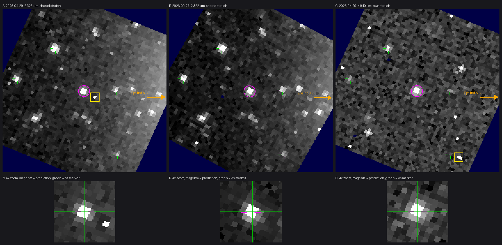

# Epsilon Indi B `fair_comparison` case review

> **Coordinator clarification (15 November 2026):** A/C is a same-exposure comparison with different wavelengths, detectors and display scales. Its different appearance rules out elapsed time; it does not isolate wavelength as the sole cause. The revised case guide (`fair_comparison-2026-11-15b`) states this explicitly. Numerical findings below are unchanged; earlier causal wording is retained as review history. See the [later comparison controls](../overnight-controls/README.md).

Reviewer: parallel worker 09, 2026-11-14. This is a review only. No processor code or products were changed. The proposed text changes are in a separate commit to `backend/content/cases/fair_comparison.json`, for Sathvik to accept or reject.

**Verdict: PASS. Keep the frames; rewrite the text.** Every per-frame fact in the case matches the original FITS. The case's weakness is its ending, not its data. The current guide ends on "I can't tell" (`qa/judging/README.md`, finding 2). The images support a concrete, honest ending instead:

- **A vs B:** Epsilon Indi B looks the same, and the field stars stay put.
- **The one A↔B difference:** a dot next to the target comes and goes. It is a flagged detector pixel.
- **A vs C:** they differ because of the color of light. At 4.94 µm the brown dwarf stands out while most stars fade.

No frame change is recommended.

## 1. Independent confirmation

Every value below was read from the original FITS in `research/build_data/raw/epsilon_indi_b/` (read only).

- **Prediction:** `targets.json` J2000 astrometry, propagated with astropy `apply_space_motion` to `MJD-AVG`.
- **Wavelength:** evaluated two ways at that position:
  - key-`W` WCS with SIP off;
  - a hand-written `-TAB` lookup.

  The two agree to better than 1e-15 µm.
- **Flags:** decoded from `MSKN`/`MSKM` in an r = 2.5 native px circle.

| Ref | frame_key (= `OBSID`_D`DETECTOR`) | Release | `DATE-AVG` (UTC) | `MJD-AVG` | λ at prediction | Bandwidth | Screen (adverse/screened) | sha256 = case |
|---|---|---|---|---|---|---|---|---|
| A | `2026W18_1A_0516_1_D3` | DR1 | 2026-04-29T12:05:47.874 | 61159.504026317 | 2.32317 µm | 0.0577 | clear (0/19, only SOURCE) | yes |
| B | `2026W39_2A_0597_4_D3` | QR3 | 2026-09-27T07:44:24.312 | 61310.322503608 | 2.32195 µm | 0.0573 | clear (0/18, only SOURCE) | yes |
| C | `2026W18_1A_0516_1_D6` | DR1 | 2026-04-29T12:05:47.874 | 61159.504026317 | 4.93988 µm | 0.0376 | clear (0/20, only SOURCE) | yes |

- **Time and wavelength:**
  - The baseline is 150.8 days.
  - Δλ(A, B) = 0.0012 µm, which is 2% of a bandwidth.
- **Agreement with the case JSON:**
  - Dates match verbatim.
  - The rounded wavelengths differ by at most 4.7e-5 µm.
- **Agreement with the processor record (`perigee-processor-a/0.1.1`):**
  - Wavelength matches to 0.
  - The marker matches to within 0.0005 display px.
- **Acceptance check reused rather than redone:** I re-ran `science/reviews/acceptance/check_acceptance.py` on the current products (`claude/perigee-integration` cd4ef49, unchanged at 866d3a9). The earlier review had checked 0.1.0. All columns PASS for A, B and C, and the 13-frame selection still has 0 failures. The checks include:
  - byte-exact PNG reconstruction;
  - Gaia registration (median 0.41 px in A, 0.67 px in B);
  - wavelength, time, flags, coverage, stretch and provenance.

  The fair_comparison rows are in `acceptance_rerun.json`.
- **Field registration, coordinator's check:** `tools/ingest/check_registration.py`, rerun here.
  - **A→B:** field shift 1.19″ raw and 0.91″ on the PNGs (0.65 display px). The marker moves 1.94″.
  - **A→C:** cross-band, so the method is not reliable for this pair.

## 2. Contact sheet



The top row shows the shipped 256 px grids at 2×, north up and east left, 1.406″ per display px:
- **Magenta circle:** the catalog prediction.
- **Green ticks:** Gaia DR3 stars that centroid cleanly in A.
- **Yellow boxes:** isolated adverse-flagged pixels.
- **Orange arrow:** the direction to Epsilon Indi A.

The bottom row is a 4× zoom on the marker:
- **Green cross:** fixed at A's marker.
- **Magenta ticks:** this frame's prediction. They are hidden under the green cross in A and C, which share the exposure.

## 3. Findings

1. **Epsilon Indi A is not in the pictures, and Eps Ind B is not confused with it.**
   - Gaia DR3 6412595290592307840, propagated to each epoch, lies 6.71′ from Eps Ind B.
   - That puts it at display (413, 138), about 157 px beyond the right (west) edge of the 256 px grid.
   - Eps Ind B is an isolated, unflagged point source at the marker in all three frames.

   The only trace of A may be the background (finding 5).

2. **A vs B: the same picture of Eps Ind B.**
   - **The field stars stay put.** Four Gaia stars that centroid cleanly in both frames shift by a median of (+0.28, −0.19) display px, at most 0.39 px in any component.
   - **The marker moves 1.38 display px (1.93″), mostly east:** dx −1.17, dy +0.72. That is a third of a native SPHEREx pixel (4.4 display px).
     - Annual parallax is not modeled, and it would change this shift by about 0.5″ (0.36 px).
     - The glow's visual center sits within 0.25 px of the marker in both frames. This is *consistent with* the prediction, but it is not a measurement.
     - For scale, the Barnard review found about 1 px scatter for this kind of visual proxy.
   - **Motion is not visible or claimable.** The marker shift is only about twice the whole-field registration offset (0.65 px). This agrees with the coordinator's conclusion. One correction: the shift is not strictly *below* the registration offset. It is too small to see because it is sub-native-pixel and within the scatter of judging a centre by eye.

3. **Brightness can't be read from A vs B, by construction.**
   - **The display is clipped.** Under the shared stretch (0.116–1.178 MJy/sr), Eps Ind B's centre is pure white in both frames (76 and 73 white display px within 6 px). So are the brightest field stars.
   - **What that means:** a modest brightness change would not show at the centre, so "looks the same" must not become "did not change".
   - **Internal direction check (not photometry, not for learner text):**
     - **Measure:** a crude background-subtracted 3×3 native-pixel box gives a ratio of a reference star (Gaia DR3 6412596458823395328, G = 13.0, upper left) to Eps Ind B.
     - **Result:** 1.62 in A and 1.58 in B, so the ordering is the same in both frames.
     - **Peaks are unreliable:** single-pixel peaks swing much more between frames, because the PSF is undersampled. That is why peak brightness is not used anywhere here.

4. **The one visible A↔B difference near the target is a detector artifact.**
   - **What and where:** a white dot about 27″ (4.5 native px) lower right of Eps Ind B appears in A only.
   - **Cause:** it is a single native pixel flagged NONFUNC ("permanently unusable"), TRANSIENT, SUR_ERROR and SOURCE, at 1.18 MJy/sr against a local 0.20 MJy/sr.
   - **Screening:** it lies outside the 2.5 px screen, so A is correctly `clear`. Processor A's flag overlay paints it red (adverse).
   - **Teaching value:** this is the best teaching moment in the case, "a change you can see that is not a change in the sky". The current text ignores it. A learner blinking A↔B *will* notice it.
   - **C has a similar artifact:** a flagged pixel at lower right (NONFUNC/TRANSIENT/SUR_ERROR, 519 MJy/sr). It is the brightest single pixel in C.

5. **Uneven background in A and B, not in C.**
   - **Direction:** the right (west) side is brighter in A and B. The west-half median exceeds the east-half median by about 1.4× and 1.3× the pixel noise. In the PNGs, the right-third median grey is 97 vs 29 on the left in A, and 74 vs 22 in B. C shows no such trend (0.1×).
   - **Not the zodiacal-light model:** the `ZODI` model is flat across the field.
   - **HALO flags do not explain it either.** They are scattered across both halves.
   - **Cause:** not established. It points toward Eps Ind A, as `CASE_SELECTION.md` already suspected.
   - **Effect for the learner:** A's background also looks a little brighter overall than B's. A learner could misread that as "A is brighter", so the case should name it as background.

6. **A vs C: what a learner can actually see.**
   - **Eps Ind B:** in C (own stretch) it is still a white spot (75 white px).
   - **Field stars:** most fade.
     - The field stars that are white blocks in A and B turn grey in C, with peak greys of 135–168.
     - Even the G = 13.0 reference star is now much less prominent than Eps Ind B. Its 3×3 box ratio drops from about 1.6 to 0.22, and it has 19 white px against 75.
     - None of the 4 (A) or 6 (B) cleanly centroiding Gaia stars passes the same test in C, which matches the acceptance review's "no Gaia star" for C.
   - **What the learner can say:** "At 4.94 µm Eps Ind B stands out while most stars fade."
   - **Why, at the level the images support:** this is consistent with brown dwarfs being relatively bright near 5 µm, while methane absorbs near 2.3 µm (T-dwarf spectra), and with stars fading toward longer wavelengths. No numbers are claimed, and grey levels are never compared across A and C.

7. **Smaller notes.**
   - `targets.json` says Ba/Bb are "~0.6 arcsec apart", while the case says "about 0.7". Both are far below a pixel; Sathvik should pick one.
   - The current `example_claim` is 382 characters. The notebook's claim field is limited to 280 (`CLAIM_MAX`), and the field's `maxLength` truncates anything longer, so a learner cannot use the example as written. The proposed one is 238.

## 4. Proposed learner text

**Opening question:**

> Did Epsilon Indi B change between April and September 2026? Blink the pictures and work out what causes each difference you see: time, color of light, or image quality.

**Steps** (the IDs are unchanged):

1. **Blink A and B.** Check each frame's date and wavelength, then watch Epsilon Indi B at the marker and the stars around it. What changes?
   - *Hint:* April 29 and September 27, 2026, at 2.323 and 2.322 µm: five months apart, in nearly the same color of light.
   - *Hint:* Epsilon Indi B stays the same white spot at the marker, and the field stars stay put.
   - *Hint:* The marker shifts by about one display pixel, a third of a SPHEREx pixel, which is too small to see here.
   - *Hint:* The brighter sky on the right is background.
2. **One thing does come and go:** a bright dot just below and to the right of Epsilon Indi B in A. Turn on "Show flagged pixels". What is it?
   - *Hint:* It is a flagged detector pixel, not something in the sky.
   - *Hint:* Epsilon Indi B itself passes the screen in both A and B. Passing means no problem flags there; it does not measure brightness.
3. **Now choose A + C.** They were taken at the same moment, at 2.32 and 4.94 µm. Which spots stay bright in C, and which fade?
   - *Hint:* Epsilon Indi B stays bright, but most field stars fade.
   - *Hint:* Brown dwarfs give off relatively more light near 5 µm, and methane absorbs near 2.3 µm. So the difference is color, not time.
   - *Hint:* C has its own contrast stretch.

**Supported:**
- A and B are a fair pair: five months apart, the same detector, wavelengths of 2.323 and 2.322 µm, and no problem flags at Epsilon Indi B.
- In A and B, Epsilon Indi B looks the same: the same white spot at the marker, with the same field stars around it. I see no change.
- The dot that appears next to Epsilon Indi B in A but not in B is a flagged detector pixel, not a change in the sky.
- A and C look different because they record different colors of infrared light at the same moment. At 4.94 µm, Epsilon Indi B stands out while most field stars fade.

**Not supported:**
- Brighter or dimmer: nothing was measured, and the centre is clipped to white in A and B.
- Visible motion: the predicted 1.9″ is a third of a pixel.
- "It changed between A and C": they were taken at the same moment.
- Comparing grey levels between A and C.
- Resolving Ba and Bb.

**Example claim** (238 characters):

> A and B are a fair pair (five months apart, 2.323 and 2.322 µm, no flags at the target), and Epsilon Indi B looks the same in both. A and C look different because C shows 4.94 µm light, where Epsilon Indi B stands out and most stars fade.

## 5. Exact JSON changes, each tied to evidence

These changes are in the separate commit. `case_id`, every `frame_key` and all per-frame facts are unchanged (§1).

| Field | Change | Evidence |
|---|---|---|
| `content_version`, `status` | Changed to `fair_comparison-2026-11-14b` and `proposed_revision_pending_science_owner` | Task rule |
| `opening_question` | Keeps the April/September hook (slide 1). Asks the learner to attribute each difference to time, color or quality. | Findings 2, 4 and 6; judging finding 2 |
| `summary` | Changed to "sort each difference into time, color or image quality" | Same |
| `background.details` | Added Eps Ind A at 6.7′ west, outside the images, and the unexplained brighter right-side background | Findings 1 and 5 |
| `display_requirements.stretch` | Now says the centres clip to white under the shared stretch | Finding 3 |
| `display_requirements.marker` | Gives 1.4 px (1.9″) mostly east. Notes this is not visible motion, so there is no guide line. | Finding 2; registration check |
| `display_requirements.flag_overlay` (new) | Step 2 needs "Show flagged pixels" | Finding 4 |
| `steps[0]` | Prompt and hint now ask the learner to *look* at the target and field stars. Adds the marker-shift scale and the background note. | Findings 2 and 5 |
| `steps[1]` | Replaces the generic quality step with the A-only flagged dot. Keeps the "passing ≠ brightness" caveat. | Finding 4 |
| `steps[2]` | Asks which spots stay bright and which fade. Adds the methane explanation, the own-stretch caveat and C's flagged dot. | Finding 6 |
| `claim_prompt` | Changed to "what did you see change, and what caused each difference?" | Judging finding 2 |
| `conclusion_guide.supported` | Four concrete observations replace "not yet a measured change" | Findings 2, 4 and 6 |
| `conclusion_guide.not_supported` | Brightness: now cites the clipping. Motion: no longer says "about 1.9″ … too small", now "a third of a pixel". Added "changed between A and C" and "grey levels across A and C". | Findings 2, 3 and 6 |
| `example_claim` | 382 → 238 characters, and ends on the A–C observation | Finding 7 |
| `limitations` | Parallax effect quantified (about 0.5″). Added "no visible change ≠ no change". | Findings 2 and 3 |
| `verification` | Now points to this review and the re-run checks | §1 |

`evidence_requirements`, `frames`, `sources` and `title` are unchanged.

## Reproduce

```bash
~/Library/Python/3.9/bin/uv venv --python /Users/sathvikloke/.local/bin/python3.12 .venv
~/Library/Python/3.9/bin/uv pip install -p .venv/bin/python astropy numpy pillow
DATA="/Users/sathvikloke/Documents/ChatGPT/NASA Space Comp/research/build_data"
.venv/bin/python science/reviews/epsilon/check_epsilon.py --data-root "$DATA"   # results.json, contact_sheet.png
.venv/bin/python science/reviews/acceptance/check_acceptance.py --data-root "$DATA" --out /tmp/acc.json
PERIGEE_DATA_ROOT="$DATA" .venv/bin/python -m tools.ingest.check_registration
```

## Limitations

- **Shared foundations:**
  - Header WCS and SIMBAD astrometry are shared with the processor.
  - Gaia DR3 is the only independent position control, and no Gaia star centroids cleanly in C.
- **Qualitative statements only.** "Looks the same", "stands out" and "fades" are visual descriptions:
  - They rest on display clipping counts, a within-frame ordering against one reference star, and Gaia-star detectability.
  - None is photometry, and no brightness value should be quoted to learners.
- **Not explained:**
  - The physical explanation for C (methane absorption, brown-dwarf colors) is general astrophysics. It was not derived from these frames.
  - The cause of the right-side background is not established.
- **Not checked:** frontend rendering of the new step text, or whether the dot in step 2 is noticeable at the app's plate size and on a phone.
