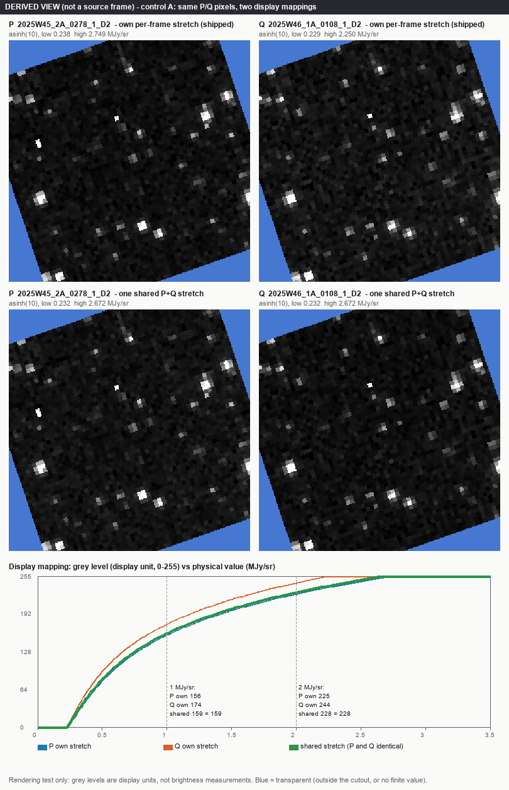
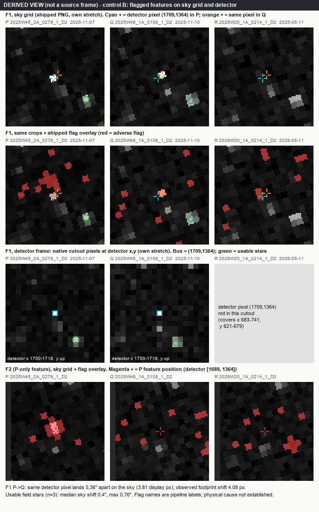
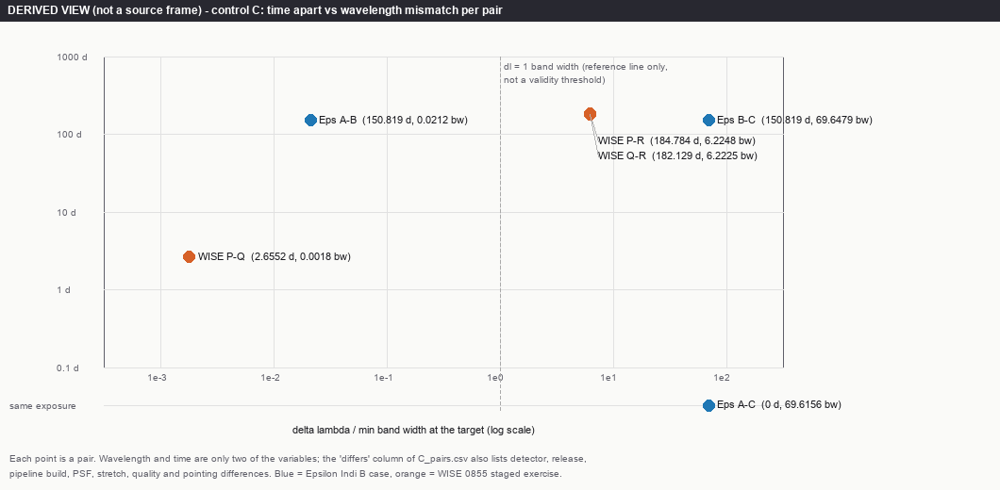
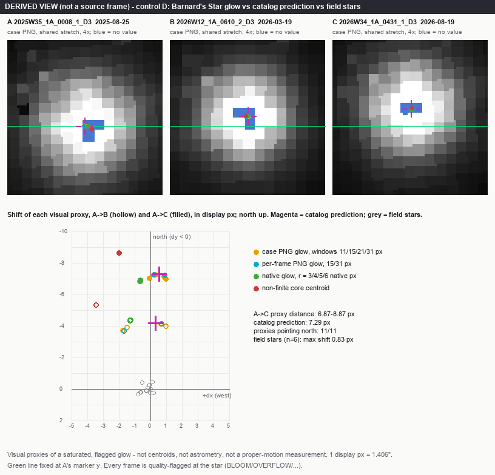
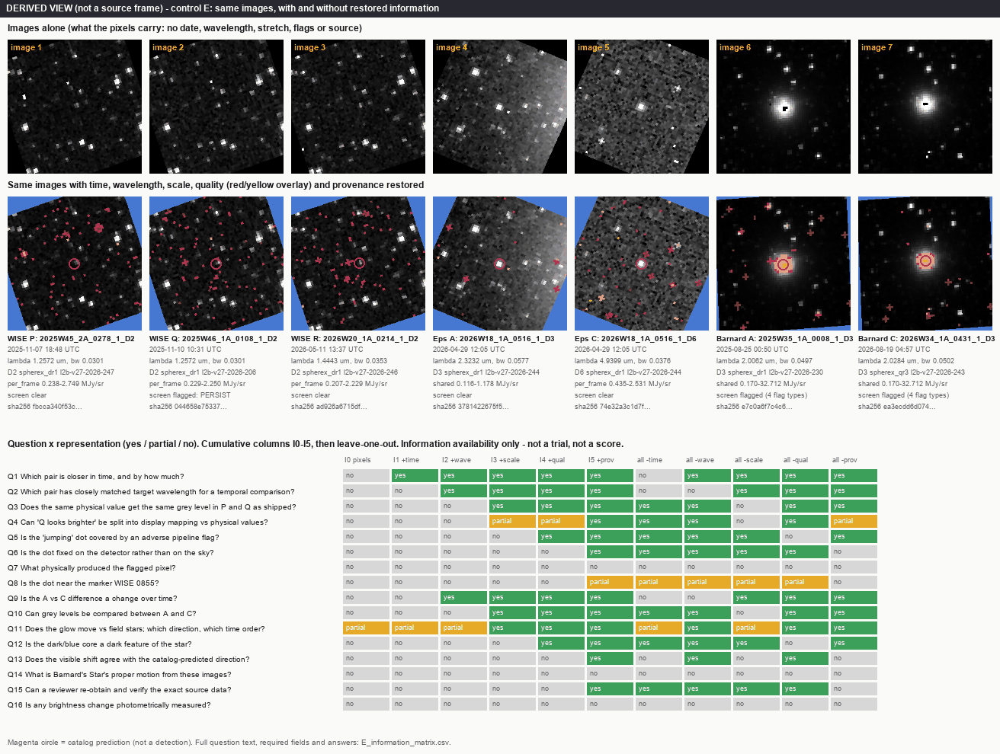

# N2 controls: five reproducible counterexample experiments

**Scope.** These are five deliberately chosen teaching examples from the retained data. They are not a representative survey of SPHEREx observations. Nothing here is:
- photometry, astrometry or a detection test;
- a learner study, a human trial or an AI benchmark;
- evidence that anyone learns faster or makes fewer mistakes.

Every number comes from `results/results.json`, which `run_controls.py` regenerates. The calculations are deterministic mappings, so results are reported with stated tolerances. There are no p-values or confidence intervals. Physical values are in MJy/sr. Display values are 8-bit grey levels (0–255) or display pixels (1.40625″ each).

Each section below gives the question, the expected invariant (written before inspecting the final numbers), the inputs, the result, the supported lesson and its limit.

| Control | Question | Headline result |
|---|---|---|
| A. Stretch | Does one MJy/sr value get one grey level? | **Per-frame stretches:** 1.0 MJy/sr → grey 156 (P) vs 174 (Q).<br>**Shared stretch:** 159 in both. Over a 0–5 MJy/sr sweep, P and Q never differ (0 levels, versus up to 19 per-frame).<br>**Rendered PNGs:** match the formula with 0 grey-level error. |
| B. Flagged feature | Is the P/Q "jumping dot" fixed on the sky or on the detector? | **The dot:** the same detector pixel (1709, 1364) in P and Q. It lands **5.36″** apart on the sky (3.81 display px).<br>**Field stars:** the 3 usable ones agree to ≤ 0.76″.<br>**Cross-check:** their detector shift predicts 5.38″ for a detector-fixed pixel.<br>**P-only feature:** absent from Q at both the same detector pixel and the same sky position. |
| C. Wavelength | Which variables differ in each pair? | **P/Q:** Δλ = 0.0018 band widths. They still differ in time, pipeline build, stretch, quality screen and sub-pixel pointing.<br>**Epsilon A/C:** the same exposure, 69.6 band widths apart, on different detectors. |
| D. Positive control | Does the Barnard glow move relative to the field stars? | **All 11 proxies:** shift A→C by 6.87–8.87 display px, toward north (−7.9° to +12.8°).<br>**Catalog prediction:** 7.29 px at −4.4°.<br>**Field stars:** at most 0.83 px. |
| E. Information removal | What can each representation answer? | A 16-question × 11-representation matrix. Four questions (cause, identity, proper motion, photometry) cannot be answered from any representation. |

## Exact command, environment and outputs

```sh
.venv/bin/python science/reviews/overnight-controls/run_controls.py \
    --data-root "/path/to/research/build_data" \
    --out science/reviews/overnight-controls/results
```

**How the script runs:**
- `--out` must be absent or empty; the script refuses to write into a non-empty directory.
- It reads only the inputs listed in `results/manifest.json`, which records the SHA-256 and size of each.
  - Those inputs are the shipped records, PNGs and flag PNGs; the two case files; `targets.json`; the cached Gaia DR3 cones; `manifest.json`; and the retained raw FITS.
  - The raw FITS stay outside Git.
- It imports processor A (`backend/data/process.py`, `perigee-processor-a/0.1.2`).

**Committed run:**
- **Machine:** macOS 26 arm64; Python 3.12.16, numpy 2.5.4, astropy 8.0.2, Pillow 13.0.0. These are in the coordinator `.venv`, built from `backend/requirements*.txt` plus Pillow.
- **Runtime:** about 1.3 s wall. Two runs into fresh directories were byte-identical except `manifest.json`, which carries the timestamp, runtime and output folder name.
- **Size:** about 0.7 MB in total.
- **Fonts:** figure fonts come from the OS (Arial on macOS), so PNG bytes may differ on another OS. The numbers do not depend on fonts.

| Output | What it is |
|---|---|
| `results.json` | All results, including the integrity block. All 12 loaded frames have record sha256 = manifest sha256 = file sha256. |
| `manifest.json` | Inputs and outputs with hashes, the environment and the runtime. |
| `A_stretch_probes.csv`, `A_{P,Q}_{per_frame,shared}.png` | Grey-level probes and the four actual 256 px renders. |
| `A_stretch_pairs.png` | The paired images plus the transfer curves (derived). |
| `B_features.csv`, `B_field_sources.csv`, `B_flagged_features.png` | Features, field stars and the sky/detector figure (derived). |
| `C_frames.csv`, `C_pairs.csv`, `C_time_vs_wavelength.png` | Per-frame variables, pair differences and the pair plot (derived). |
| `D_barnard_proxies.csv`, `D_barnard_proxies.png` | Every proxy, every window and the prediction (derived). |
| `E_information_matrix.csv`, `E_information_removal.png` | The matrix and the contact sheet (derived). |

Every figure carries a "DERIVED VIEW (not a source frame)" banner. Source frames are never modified.

## How this improves the demo and the answer key

1. **The "Q looks brighter" trap is now quantitative and runs the other way.**
   - **As shipped:** P's median grey is 16 and Q's is 20.
   - **Physical values:** Q's median grid value is 0.971 × P's (0.2777 vs 0.2861 MJy/sr).
   - **Under one shared stretch:** Q's median grey drops to 16 and P's rises to 19.
   - **For N1:** the answer should be that the impression is not supported by the physical values. This is still not photometry, and the cause of the roughly 3% physical difference is not established. The impression is not "a pure display effect".
2. **The jumping dot is now a two-frame-of-reference demonstration.**
   - **On the sky grid:** the stars stay put and the dot moves.
   - **On the detector:** the dot stays put and the stars move by 0.87 native px.
   - **Independent prediction:** the stars' measured detector shift predicts the dot's 5.36″ sky jump to within 0.02″. This is stronger evidence than "it is absent in R".
   - **Absence in R is a sky-position statement only:** R's cutout does not contain detector pixel (1709, 1364).
3. **Wavelength matching is reported relative to the band width, with every other difference listed.**
   - **No universal rule:** the processor's shared-stretch rule (Δλ < min band width, same detector) is labeled as a display grouping rule, not a validity threshold.
   - **The table makes defect 1 of the N1 assignment concrete:** "differs only in time" is false for P/Q.
4. **The positive control shows the workflow can reach "it moved".**
   - Every proxy, across every window, points north by about the predicted amount. Field stars move 8× less.
   - The saturated-core warning and the catalog prediction stay as separate blocks in the results.
5. **The information-removal matrix states what each restored field contributes, question by question.** It replaces any appeal to a score.

### Specific changes N1's answer key should adopt (from these numbers)

- **"Q looks brighter":** use the median greys (16 vs 20), the physical median ratio (0.971) and the shared-stretch reversal (19 vs 16). Say "not supported by the physical values; cause of the small physical difference not established". Do not say "only display".
- **Jumping dot:**
  - Quote **5.4″** (5.36″, 3.8 display px). The P→Q pointing change at that position is **0.87 native px**: median star detector shift (−0.83, −0.28) px.
  - Cite the star-implied 5.38″ check.
  - Drop "absent from R" as evidence for a detector origin, or reword it as "nothing is at that sky position in R". R cannot test the detector pixel.
- **Flags at the jumping dot:**
  - **P:** bits 0, 2, 6 and 21, which are TRANSIENT, SUR_ERROR, NONFUNC and SOURCE. SOURCE is informational: "Pixel mapped to a known source".
  - **Q:** bits 0, 2 and 6 only.
  - **Wording:** quote the FITS `MSKD` meanings and claim no cause. The informational SOURCE bit in P is a pipeline mask label, not a detection.
- **P-only dot:**
  - **What it is:** two adjacent native pixels, 12.55 and 8.38 MJy/sr, against a local background of about 0.29. Flags: TRANSIENT, SUR_ERROR, OUTLIER, HALO.
  - **Same detector pixel in Q (2.66 d later):** 0.270 MJy/sr, unflagged.
  - **Same sky position:** Q 0.231 and R 0.270 MJy/sr.
  - **Supported:** it is not repeated at the same detector pixel or sky position in Q, nor at the same sky position in R. A cause is not supported.
- **P/Q "fair pair":** P/Q has closely matched target wavelength (0.0018 band widths). It still differs in:
  - time (2.655 d);
  - pipeline build (`l2b-v27-2026-247` vs `-206`);
  - per-frame stretch (high 2.749 vs 2.250);
  - quality screen (Q: PERSIST, 2/19);
  - sub-pixel pointing (target detector position 0.87 px apart; same rounded pixel).

  Release (DR1), detector (D2), SSDC software (7.0.5) and field rotation (0.0°) are the same.
- **Staging decision for N1/N7:** by Perigee's own ingest rule, P/Q *would* receive a shared stretch if staged as a case (same detector, Δλ < min band width). The candidate case must therefore choose one of two options, and say which:
  - keep the per-frame stretch on purpose and state that the trap is part of the task (N7's "explicitly treat their absence" clause);
  - adopt the shared stretch and drop the brightness trap.

---

## A. Stretch control

**Question.** Does one physical value (MJy/sr) receive different grey levels under the shipped per-frame stretches of P and Q, and the same grey level under one shared stretch?

**Expected invariant (stated first).**
- Under any single stretch, grey is a fixed function of the physical value. Every rendered pixel must equal `round(255·asinh(10·t)/asinh(10))`, with `t = clip((v − low)/(high − low), 0, 1)`, to within **0 grey levels**.
- Under a shared stretch, P and Q use the identical function, so their difference is 0 for every value.
- Under per-frame stretches, the functions differ wherever `low`/`high` differ.

**Inputs.**
- **Frames:** P `2025W45_2A_0278_1_D2` and Q `2025W46_1A_0108_1_D2`, as shipped in `backend/content/presets/wise_0855/frames/`, plus their raw FITS.
- **Renders:** processor A re-run per-frame, then re-run with `display_limits` = the pooled 1–99.5 percentiles of P+Q. That is the rule `tools/ingest` uses for authored cases.
- **Finite-value treatment:** a display pixel is finite when its native IMAGE value is finite and VARIANCE is finite and > 0. Non-finite pixels are transparent and are excluded from percentiles and statistics.

**Result.**
- **Reproduction:** the per-frame re-run reproduces the shipped PNG bytes and `display_scale` exactly for both frames.
- **Stretch parameters:**
  - P per-frame: 0.2378–2.7495 MJy/sr.
  - Q per-frame: 0.2291–2.2498 MJy/sr.
  - Shared: **0.23187–2.67191** MJy/sr (asinh, softening 10).
- **Mapping check:** in all four renders, the PNG alpha equals the finite mask, and **0 pixels** differ from the formula (maximum |error| = 0 grey levels).

| MJy/sr | P own | Q own | Q − P | P shared | Q shared | Q − P |
|---|---|---|---|---|---|---|
| 0.25 | 4 | 9 | +5 | 6 | 6 | 0 |
| 0.5 | 78 | 94 | +16 | 81 | 81 | 0 |
| **1.0** | **156** | **174** | +18 | **159** | **159** | 0 |
| 1.5 | 197 | 216 | +19 | 200 | 200 | 0 |
| **2.0** | **225** | **244** | +19 | **228** | **228** | 0 |
| 2.5 | 246 | 255 | +9 | 249 | 249 | 0 |
| 3.0 | 255 | 255 | 0 | 255 | 255 | 0 |

- **Sweep from 0 to 5 MJy/sr in 0.001 steps:**
  - per-frame P and Q differ on 50% of values, by up to **19** levels (largest at 0.706 MJy/sr);
  - shared: **0** everywhere.
- **On real pixels:** pixels within ±0.02 MJy/sr of a probe show grey ranges inside the formula's range over that bin (`A_stretch_probes.csv`). For example:
  - 76 P pixels near 1.0 MJy/sr: 154–157 per-frame, 157–160 shared;
  - 19 Q pixels near 1.0 MJy/sr: 175 per-frame, 159 shared;
  - 18 Q pixels near 2.0 MJy/sr: 244 per-frame, 228 shared.
- **Frame-wide:**

  | | Median grey | Physical median (MJy/sr) | 16th–84th percentile (MJy/sr) |
  |---|---|---|---|
  | P per-frame | 16 | 0.2861 | 0.2634–0.3156 |
  | Q per-frame | 20 | 0.2777 | 0.2554–0.3051 |
  | P shared | 19 | | |
  | Q shared | 16 | | |



**Supported lesson.**
- Under the shipped per-frame stretches, the same physical value is drawn up to 19 grey levels apart in P and Q. Under one shared stretch it is drawn identically.
- In these two frames, Q's darker-sky physical median gets a *brighter* median grey because of the per-frame stretch. So "Q looks brighter" is not supported by the physical values.

**Limit.**
- This is a rendering test. It does not establish that every frame-wide brightness difference has only a display cause: the physical medians differ by about 3%, for a reason not established here.
- The grid median is descriptive, not photometry. The shared stretch is a review render, not a product change.
- The 1.5 and 3.0 MJy/sr probes have no real pixels within ±0.02 in either frame. 2.0 has pixels only in Q, and 2.5 only in P. Those rows rest on the verified formula.

## B. Flagged-feature control

**Question.** Is the dot that "jumps" between P and Q fixed on the sky (as a source would be) or fixed on the detector? Where is the P-only dot, and is anything there in Q or R?

**Expected invariant (stated first).**
- **Detector-fixed feature:** it keeps the same detector coordinate. Its sky positions differ by the pointing change, and the usable field stars' detector shift predicts that change.
- **Sky-fixed source:** it moves together with the stars, which agree to within centroid noise (well under 1″ for clean stars here).

**Inputs.**
- **Frames:** raw P, Q and R FITS, with the IMAGE, FLAGS and VARIANCE extensions, the celestial TAN-SIP WCS and the key-A detector WCS; plus the shipped records, PNGs and flag overlays.
- **Gaia cone:** `science/reviews/acceptance/gaia/wise_0855.csv` (G < 17).
- **The P-only feature is found by a census, not hard-coded.** The census takes native local maxima drawn white by the frame's own stretch, keeps those with adverse flags, and drops any with a cached Gaia star within 9″.

**Coordinate conventions (cutout origin).**

| System | Definition |
|---|---|
| Native | 0-based FITS pixel centres of each cutout's IMAGE (FITS 1-based = native + 1). |
| Detector | WCS key A, `WCSNAMEA = '0-based active pixel coordinates'`, LINEAR: detector = native + 1 − CRPIXnA. |
| Display | Processor A grid: origin at the PNG top-left, pixel centres at i + 0.5, north up and east left, 1.40625″/px. |
| Sky | ICRS RA/Dec from the TAN-SIP WCS at the native pixel centre. |

The CRPIXnA values differ between cutouts:
- **P:** CRPIX1A/2A = −1679/−1323, so detector = native + (1680, 1324).
- **Q:** CRPIX1A/2A = −1678/−1323, so detector = native + (1679, 1324).
- **R:** CRPIX1A/2A = −682/−620. R covers detector x 683–741 and y 621–679.

**Convention trap (recorded, avoided).** The IMAGE header's SIP coefficients belong to the celestial solution, but astropy attaches them to the key-A WCS too. `all_pix2world` on that WCS shifts detector coordinates by about 14–25 px. The script strips SIP before building the detector WCS. The earlier `check_transfer.py` used `wcs_pix2world`, which does not apply SIP, so its detector coordinates were already correct.

**Result: F1, the P/Q feature at detector (1709, 1364).**

| | P | Q | R |
|---|---|---|---|
| Native (0-based) | (29, 40) | (30, 40) | not in cutout |
| FITS (1-based) | (30, 41) | (31, 41) | — |
| RA, Dec (deg) | 133.764927, −7.224568 | 133.763743, −7.223653 | — |
| Display | (114.89, 82.91) | (117.90, 80.57) | — |
| Value (MJy/sr) | 234.547 | 237.912 | — |
| Brightest neighbour (MJy/sr) | 0.336 | 0.313 | — |
| Peak / brightest neighbour | 698× | 760× | — |
| FLAGS | 2097221: bits 0, 2, 6, 21 | 69: bits 0, 2, 6 | — |
| Flag names | TRANSIENT, SUR_ERROR, NONFUNC, plus SOURCE (informational) | TRANSIENT, SUR_ERROR, NONFUNC | — |

- **Apparent shift P→Q:**
  - The same detector pixel lands **5.36″** apart on the sky: Δdisplay (+3.01, −2.34), or 3.81 px.
  - The observed display footprint (20 display px in each frame) shifts **4.08 px**. That is 0.30 px from the detector-fixed prediction, within the ±0.5 px per axis per frame quantization of nearest-neighbour blocks.
- **Usable field sources (strict tier, n = 3):**
  - **Selection:** SNR ≥ 15, no single-pixel spike, no adverse flag in the 5×5 window, within 1 native px of the Gaia position.
  - **Sky shift:** median **0.40″**, maximum **0.76″**. On the display grid: median 0.36 px, maximum 0.69 px.
  - **Detector shift:** median **(−0.83, −0.28) px**, so the pointing changed by 0.87 native px.
- **Star-implied prediction:** for a detector-fixed pixel, computed from P's WCS and the stars' detector shift only. It gives **5.38″** against the measured 5.36″ (difference 0.02″).
- **Relaxed tier (sensitivity), n = 4:**
  - **Selection:** SNR ≥ 8, flags allowed.
  - **Result:** median 0.58″, maximum 1.62″. The 1.62″ star is the flagged marker neighbour, Gaia DR3 5756956644387831296.
- **P's sky position in the other frames:**
  - **Q:** it falls in detector pixel (1708, 1364), which holds 0.313 MJy/sr and is unflagged. The brightest value within 1.5 native px is the feature itself, one pixel away.
  - **R:** 0.289 MJy/sr, with an OUTLIER flag on that pixel.
  - **The detector pixel itself is not in R's cutout.**

**Result: F2, the P-only feature.** The census found exactly one candidate besides F1.

| | Value |
|---|---|
| P native / detector | (9, 40) / **(1689, 1364)** |
| RA, Dec (deg) | 133.797395, −7.235856 |
| Display | (32.44, 111.81) |
| Peak | 12.552 MJy/sr, with 8.376 MJy/sr in the pixel to its north (peak / neighbour 1.5) |
| Display footprint | 38 display px |
| Flags | bits 0, 2, 19, 28: TRANSIENT, SUR_ERROR, OUTLIER, HALO |
| P background median | 0.286 MJy/sr |
| Q, same detector pixel, native (10, 40) | **0.270** MJy/sr, no adverse flag |
| Q, same sky position | 0.231 MJy/sr, unflagged |
| R, same sky position | 0.270 MJy/sr, unflagged |
| R, same detector pixel | not covered |

**Flag meanings (FITS `MSKD`).**
- TRANSIENT: "Transient detected during SUR"
- SUR_ERROR: "Error in onboard processing"
- NONFUNC: "Permanently unusable"
- OUTLIER: "Pixel flagged by Detect Outliers"
- HALO: "Pixel part of a transient halo"
- SOURCE: "Pixel mapped to a known source" (informational in Perigee)



**Supported lesson.**
- **F1:** a single flagged native pixel that keeps its detector coordinate. Its 5.4″ sky "jump" equals the pointing change implied by the field stars, while those stars agree to ≤ 0.76″. The evidence changes a defensible reading from "something moved" to "a flagged detector pixel appears in a different sky place because the pointing changed".
- **F2:** a two-pixel flagged feature present only in P. It is absent at both the same detector pixel and the same sky position in Q, and at the same sky position in R.

**Limit.**
- No physical cause is established for either feature. Flag names are pipeline labels.
- The strict field-star sample is small (n = 3).
- R cannot test whether detector pixel (1709, 1364) is elevated later.
- Positions use each frame's header WCS (shared with processor A). Gaia is the independent reference.

## C. Wavelength, time and provenance control

**Question.** For Epsilon Indi B A/B/C and WISE 0855 P/Q/R, which observing, processing and display variables differ in each pair? How closely are the target wavelengths matched relative to the band widths?

**Expected invariant (stated first).**
- **Epsilon A/C:** the same exposure (Δt = 0) at very different wavelengths.
- **P/Q:** small Δλ relative to the band width, with other variables still differing.
- **P/R:** several band widths apart.

No threshold is used to decide "matched". Discrete variables are listed when they are not exactly equal, and continuous ones are given as numbers.

**Inputs.**
- **Records:**
  - the shipped `case-fair_comparison` records for Epsilon A/B/C (the case's own products: A/B use a shared stretch, C a per-frame one);
  - the shipped `wise_0855/frames` records for P/Q/R (per-frame).
- **Raw-header cross-checks:** DATE-AVG, DETECTOR, OBSID, PRIMARY VERSION and PSF_FWHM. The wavelength is re-evaluated through the key-W WCS at the record's sampled position.
- **Normalization:**
  - primary: **Δλ / min(bandwidth₁, bandwidth₂)**, using each record's `bandwidth_um` (the WCS-WAVE approximated per-pixel band width at the target);
  - also reported: Δλ/mean(bw), Δλ/mean(λ), and a top-hat band overlap (an idealization: real channel responses are not top-hats).

**Result.**
- **Cross-checks:** every date matches its header, and every re-evaluated wavelength matches its record to 0.0.

| Pair | Δt | Δλ (µm) | Δλ / min bw | Top-hat overlap | Same detector | Variables that differ |
|---|---|---|---|---|---|---|
| Eps A–B | 150.82 d | 0.00122 | **0.021** | 0.98 | yes (D3) | time; exposure; λ/bw; release (DR1 vs QR3); pipeline build (-244 vs -271); pointing (target 603 detector px apart; field rotated 174.8°) |
| Eps A–C | **0 (same exposure)** | 2.6167 | **69.6** | 0 | no (D3 vs D6) | λ/bw; detector; header PSF FWHM (7.45″ vs 9.04″); stretch (shared vs per-frame). Detector coordinates are not compared across different arrays. |
| Eps B–C | 150.82 d | 2.6179 | 69.6 | 0 | no | time; exposure; λ/bw; detector; release; pipeline build; header PSF FWHM; stretch |
| WISE P–Q | 2.655 d | 0.000055 | **0.0018** | 0.998 | yes (D2) | time; exposure; λ/bw (tiny); pipeline build (-247 vs -206); stretch (per-frame, different limits); quality screen (Q: PERSIST, 2/19); pointing (0.87 px; same rounded pixel, rotation 0.0°) |
| WISE P–R | 184.78 d | 0.1871 | **6.22** | 0 | yes (D2) | time; exposure; λ/bw; pipeline build; stretch; pointing (1220 detector px apart; rotated 179.9°) |
| WISE Q–R | 182.13 d | 0.1870 | 6.22 | 0 | yes | as P–R, plus quality screen |

- **What every pair shares:** SSDC software 7.0.5, processing version `perigee-processor-a/0.1.2`, L2 DQA "Pass" and exposure 113.583 s.
- **Perigee's display grouping rule** (same detector and Δλ < min band width) is met by Eps A–B and WISE P–Q only. It is labeled as a display rule, not a validity criterion.



**Supported lesson.**
- Epsilon A/C are taken at the same moment, so their difference cannot be a change over time. Their wavelengths are about 70 band widths apart, on different detectors.
- P/Q are the closely wavelength-matched pair for a temporal comparison (0.18% of a band width). They are not identical in anything but detector, release and software: build, stretch, quality screen and sub-pixel pointing all differ.
- P/R mixes about 185 days with a 6.2-band-width wavelength change.

**Limit.**
- **"Matched" is relative and chosen; it is not a law.** Whether a wavelength difference matters depends on the source spectrum, PSF, sampling, sensitivity and the question being asked.
- The header `PSF_FWHM` ("PSF FWHM Median") is identical for all exposures of a detector here (7.448″ D3, 7.461″ D2, 9.042″ D6). It describes the detector or band, not the exposure.
- Band widths are the pipeline's approximation at one pixel.

## D. Positive visual control (Barnard's Star)

**Question.** In the shipped `moving_neighbor` case, do image-based visual proxies show the glow moving relative to the field stars, in the direction and roughly by the size of the catalog prediction? How much do they depend on method and window?

**Expected invariant (stated first).**
- If the star moves, every reasonable proxy should shift the same way, north by several display px from A to C.
- Clean field stars should shift ≪ 1 native px (4.4 display px).
- The proxies should scatter around the prediction by about a pixel, because the core is saturated.

**Inputs.**
- **Frames:** A `2025W35_1A_0008_1_D3`, B `2026W12_1A_0610_2_D3` and C `2026W34_1A_0431_1_D3`. Each comes as the case PNG (shared stretch 0.170–32.712 MJy/sr), the shipped per-frame preset PNG and the raw FITS.
- **Gaia cone:** `science/reviews/acceptance/gaia/barnards_star.csv`.
- **All 34 retained Barnard frames,** for one fixed proxy.

**Saturated-core warning (kept separate).** Every case frame is `flagged` at the star:

| Frame | Adverse / screened pixels | Flags | Non-finite pixels in the screen | Transparent display px within 10 px of the marker |
|---|---|---|---|---|
| A | 19/19 | BLOOM, OVERFLOW, SUR_ERROR, TRANSIENT | 3 | 61 |
| B | 20/20 | BLOOM, OVERFLOW, SUR_ERROR, TRANSIENT, NONFUNC | 3 | 56 |
| C | 19/19 | BLOOM, OVERFLOW, SUR_ERROR, TRANSIENT | 2 | 38 |

**Catalog prediction (kept separate, not measured).** These are processor A marker shifts. Annual parallax is not modeled.

| | Shift | Distance | Direction |
|---|---|---|---|
| A→B | (+0.32, −4.18) display px | 4.19 px | |
| A→C | (+0.56, −7.27) display px | **7.29 px (10.25″)** | **−4.4°** from north (east positive) |

**Result: all 11 proxies, none selected.** Units are display px; the direction is measured from north, with east positive.

| Proxy family | Windows | A→B | A→C | A→C direction |
|---|---|---|---|---|
| Glow centre, case PNG (shared stretch; transparent core counted white) | 11, 15, 21, 31 px | 4.12–4.19 | 7.01–7.25 | −7.9° to +0.3° |
| Glow centre, per-frame preset PNG | 15, 31 px | 4.05–4.19 | 7.25–7.27 | −7.2° to −1.8° |
| Glow centre, native pixels (non-finite = window max), mapped via the WCS | r = 3–6 native px | 4.53–4.54 | 6.87–6.92 | +5.2° to +5.5° |
| Centroid of the non-finite core pixels | r = 3 native px | 6.36 | 8.87 | +12.8° |

- **Direction:** all 11 proxies point north (dy < 0) for both A→B and A→C.
- **A→C range:** 6.87–8.87 px; excluding the non-finite-core centroid, 6.87–7.27 px.
- **Proxy minus prediction (A→C):** 0.25–2.88 px.
- **Field stars:**
  - **Selection:** 6 Gaia stars (G 11.9–14.8), centroided on the case PNGs, not flag-filtered, as in the Barnard review.
  - **Shift:** at most **0.83 px** in any pair.
  - **Ratio:** the smallest A→C proxy shift is 8.3× the largest field-star shift.
- **All 34 retained frames:** the native r = 4 proxy minus the marker has a median of (−0.06, +0.24) px and |offset| of 0.15 / 0.66 / 2.67 px (minimum / median / maximum). These frames span detectors 1–6 and 0.8–4.7 µm. This is a descriptive spread, not a sampling uncertainty.



**Supported lesson.**
- On a common sky grid, Barnard's Star's saturated glow shifts north by about 7 display px (about 10″) from August 2025 to August 2026, while the field stars stay within 0.83 px.
- That direction and size are consistent with the catalog prediction. The workflow can therefore reach a supported qualitative "it moved", not only "artifact".

**Limit.**
- The proxies are visual, not centroids. The core is saturated, non-finite and flagged.
- Methods disagree by up to 2.0 px in size and about 21° in direction. The PNG proxies lean west of north (−7.9° to +0.3°) and the native proxies east (+5.2° to +5.5°).
- No proper motion, speed or position is measured.
- The marker comes from the same catalog astrometry, propagated without parallax.

## E. Information-removal matrix

**Question.** Which investigation questions can and cannot be answered from the images alone? Which become answerable when time, wavelength, scale, quality and provenance are restored?

**Expected invariant (stated first).**
- Questions about cause, identity, proper motion or photometry stay unanswerable in every representation.
- Each other question becomes answerable exactly when the fields its computation needed are present.

**Inputs.**
- the computed results of controls A–D;
- the shipped PNGs and records of WISE P/Q/R, Epsilon A/C and Barnard A/C;
- a scan of PNG chunks.

**Representations.** There are 11 columns.

| Column | Fields |
|---|---|
| I0 | pixels only |
| I1–I5 | I0, then cumulatively + time, + wavelength, + scale, + quality, + provenance |
| Leave-one-out (5 columns) | all fields minus one |

What each field means:

| Field | Contents |
|---|---|
| pixels | the PNG arrays only. They are already on a common grid, but neither the grid nor the order is stated. |
| time | mid-exposure date and time |
| wavelength | λ and band width at the target |
| scale | the stretch parameters plus grid scale, orientation and registration |
| quality | the screen status, flag overlay and flag meanings |
| provenance | frame keys, detector, release, build, hashes, URLs, raw-FITS access and the marker labeled as a catalog prediction |

**Rule.** A cell is `yes` when all required fields are present, `partial` when a listed subset is present, and otherwise `no`. Required fields were assigned from what the computation in A–D actually needed. Each `yes` cell's answer text is filled from computed values.

**Result.** The full table is in `E_information_matrix.csv`.

| ID | Question | Images only | Needs | Never answerable |
|---|---|---|---|---|
| Q1 | Which pair is closer in time? | no | time | |
| Q2 | Which pair is wavelength-matched for a temporal comparison? | no | time + wavelength | |
| Q3 | Same physical value → same grey in P/Q? | no | scale | |
| Q4 | Split "Q looks brighter" into display vs physical | no | scale (partial) + provenance/raw | |
| Q5 | Is the jumping dot under an adverse flag? | no | quality | |
| Q6 | Detector-fixed or sky-fixed? | no | provenance (raw detector WCS) | |
| Q7 | Physical cause of the flagged pixel | no | — | **yes** |
| Q8 | Is the dot by the marker WISE 0855? | no | provenance gives "marker = prediction" (partial) | **identity: yes** |
| Q9 | Is Eps A vs C a change over time? | no | time + wavelength | |
| Q10 | Compare grey across Eps A/C? | no | scale | |
| Q11 | Glow moves relative to stars; direction; time order? | **partial** | pixels + scale + time | |
| Q12 | Is the dark core a dark feature? | no | quality | |
| Q13 | Shift agrees with the predicted direction? | no | pixels + time + scale + provenance | |
| Q14 | Barnard's proper motion from these images | no | — | **yes** |
| Q15 | Re-obtain and verify the exact source data | no | provenance (12/12 hashes agree) | |
| Q16 | Any photometric brightness change | no | — | **yes** |

**Evidence that "images alone" means what it says:**
- **No metadata in the files:** none of the 9 shipped PNGs scanned (WISE P/Q/R, Epsilon A/B/C, Barnard A/B/C) carries tEXt, zTXt, iTXt, eXIf or tIME chunks, so no date, λ, stretch or source travels with the file.
- **Nothing in the pixels marks the flagged dot:** in the P PNG, the flagged feature F1 reaches grey 255 (20 white px in a 7×7 box), and so does the brightest usable field star (29 white px). The two fainter usable stars peak at 195 and 145. Nearest-neighbour resampling turns each native pixel into a block about 4.4 display px across. A compact block hints at a single native pixel, but the pipeline's flag judgement is not in the pixels.



**Supported lesson.**
- From pixels alone, only Q11 is partly answerable: a positional difference is visible, but co-registration, north and time order are unstated.
- Restoring each field unlocks specific questions:
  - **Time and wavelength:** Q1, Q2 and Q9.
  - **Scale:** Q3 and Q10.
  - **Quality:** Q5 and Q12.
  - **Provenance:** Q6, Q13 and Q15.
- Leave-one-out confirms that each field is necessary for at least two questions.
- Four questions stay unanswerable in every column. That is where Perigee should say "not established" rather than offer an answer.

**Limit.**
- This compares the information available in each representation. It is not a measurement of what people do with it: not a human or AI trial, and no score.
- The question set and the required fields are authored choices, made explicit in the CSV.

---

## Negative, failed and limiting results (recorded, not hidden)

1. **WISE P/Q has only 3 strict usable field stars.** The relaxed tier has 4; its median rises to 0.58″ and its maximum to 1.62″ because it includes the flagged star near the marker.
2. **R cannot test the detector-fixed hypothesis for F1.** R's cutout is on detector x 683–741, so "absent in R" is only a sky-position statement.
3. **The physical background differs between P and Q** (median ratio 0.971). The display test cannot explain or remove it; its cause is not established.
4. **Probe values lack real pixels in some bins.** 1.5 and 3.0 MJy/sr have no real pixels within ±0.02 in either frame; 2.0 has them only in Q and 2.5 only in P. Those rows rest on the formula, which was itself verified on every rendered pixel.
5. **The Barnard proxies disagree by method.**
   - The non-finite-core centroid overshoots the prediction by 1.6 px (8.87 vs 7.29) and points +12.8°.
   - The native and PNG proxies lean to opposite sides of north.
   - None is a measurement.
6. **The header PSF_FWHM cannot distinguish exposures.** It is constant per detector across these exposures.
7. **A convention trap, avoided.** `all_pix2world` on the key-A detector WCS applies the celestial SIP terms and shifts detector coordinates by about 14–25 px. It is documented, and the script strips SIP. The earlier transfer check used `wcs_pix2world` and is unaffected.

## Selection transparency

- **Frames:**
  - WISE P/Q/R were fixed by the B5 transfer exercise, which the script asserts against `transfer-exercise/results.json`.
  - Epsilon and Barnard frames are read from the shipped case files.
- **Features:**
  - F1 is the detector pixel named in the assignment.
  - F2 comes from a census rule, not chosen by eye.
- **Field stars:** cached Gaia stars passing stated cuts. The strict and relaxed tiers are both reported.
- **Barnard proxies:** every window and method is reported. A fixed proxy is also run on all 34 retained frames.
- **Representativeness:** these remain handpicked teaching counterexamples. No population-level reliability is claimed.
