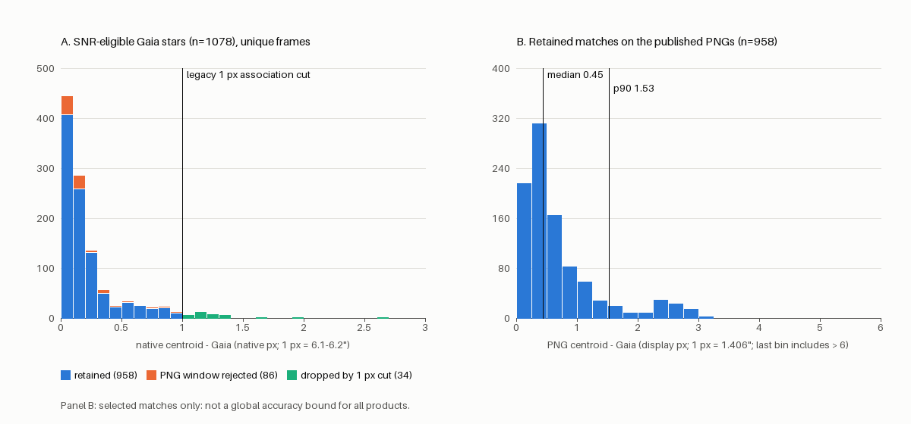
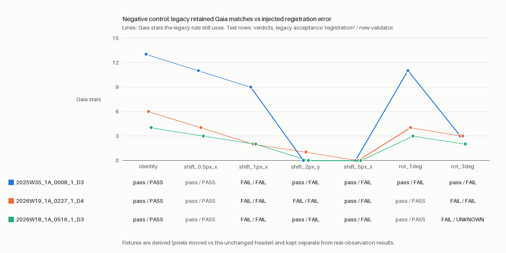

# N3 registration and astrometric-validity audit (processor A)

Reviewer: N3 science worker, 2026-11-14/15. This is a review only. No processor code, products or the acceptance validator were changed. Everything here lives in `science/reviews/registration-audit/`. It reads the raw cutouts (read only), the published products in `backend/content/presets/`, and the cached Gaia DR3 controls in `science/reviews/acceptance/gaia/`. No catalog was downloaded.

## Bottom line

- **Not every product has an independent check.** The 189 products are **183 unique raw cutouts plus 6 case re-renders** (109 exposures). Of the 183 cutouts, **156 have at least one Gaia DR3 field star in the published registration check, and 27 have none**. These 27 are 25 R Draconis frames, fair_comparison C (`2026W18_1A_0516_1_D6`) and `wise_0855 2025W19_1B_0116_2_D6`. Header-WCS reconstruction of the PNG passes for all 189, but it shares the header with the processor and is **not** independent validation.
- **The old headline is reproduced exactly.** It is 0.45 display px, the median over 161 records of each record's median PNG offset, with a worst record of 2.01 px. It is a statistic of a **selected** sample: SNR ≥ 15, a centroid within 1 native px of Gaia, and a clean PNG window. It is not a global accuracy bound.
- **Some frames could pass with no evidence at all.** If the header registration were wrong by 2 or 5 native px, the unmodified acceptance validator would still report `registration: True` on the Barnard and Eps Ind fixtures, and on WISE at 5 px. Every Gaia star is lost to the 1 px association cut or to the forced-window SNR cut. The PNG reconstruction also agrees, because it trusts the same wrong header. This is the "easy survivors" failure mode.
- **A new validator closes that gap.** It is `regcheck.registration_verdict`, using WCS-free detections, offset voting and a rotation scan. On the same fixtures it reports **FAIL for every 1, 2 and 5 px shift** on all three frames and recovers the injected offset to within 0.2 px. On the 183 real frames it reports **0 FAIL, 128 PASS and 55 UNKNOWN**.
- **fair_comparison C stays `unknown` for independent field-star validation.** Two relative controls now constrain it:
  - The target's sky position agrees with its Gaia-checked same-exposure sibling A to **0.15″** (0.024 native px).
  - The one G = 13.9 Gaia star visible in C (at SNR 8.6, below the cut) lies 0.29 native px from Gaia.
- **No correctness bug was found in processor A.**

## Reproduce (one command, clean output directory)

From the repository root:

```bash
DATA="/Users/sathvikloke/Documents/ChatGPT/NASA Space Comp/research/build_data"
PY="/Users/sathvikloke/Documents/ChatGPT/NASA Space Comp/.claude/worktrees/perigee-parallel-coord-4aa087/.venv/bin/python"
rm -rf science/reviews/registration-audit/results && "$PY" science/reviews/registration-audit/audit_registration.py --data-root "$DATA" --out-dir science/reviews/registration-audit/results && PERIGEE_BUILD_DATA="$DATA" "$PY" -m pytest science/reviews/registration-audit/tests -q -p no:cacheprovider
```

The audit takes about 10 s and the tests about 5 s. The script refuses a non-empty `--out-dir`. Outputs carry no timestamps: a second run into a fresh directory was `diff -r` identical to the committed `results/`.

Environment: Python 3.12.16, numpy 2.5.4, astropy 8.0.2 and Pillow 13.0.0, with no matplotlib or scipy. Input hashes (manifest, the 5 Gaia CSVs, the 7 `frames.json`) are in `results/run_info.json`. Without raw data, the 9 synthetic tests still run and the 6 real-data tests skip.

| File | Contents |
|---|---|
| `results/inventory.json` | Raw vs product counts, case copies, frames with no star check |
| `results/funnel_per_frame.csv`, `results/funnel_summary.json` | Per-frame selection funnel, totals and stage definitions |
| `results/residual_stars.csv`, `results/residual_summary.json` | Per-star residuals for every SNR-eligible star, with quantiles and strata |
| `results/sensitivity.csv` | SNR × association grid, centroid size, target exclusion |
| `results/blind_matching.json`, `results/blind_matching_per_frame.csv` | WCS-free detections vs Gaia, with chance rate and ambiguity |
| `results/validator_real_frames.csv` | New validator verdict per raw cutout |
| `results/negative_control.json`, `results/negative_control.png` | Derived fixtures, the legacy validator and the new validator |
| `results/fair_comparison_c.json` | C funnel, lower SNR thresholds and relative controls |
| `results/barnard_separation.json` | Marker, glow proxy and field-star residuals kept apart |
| `results/residuals.png` | Residual distributions |

## 1. Inventory: what is independent

| Item | Count | Note |
|---|---|---|
| Manifest file entries | 188 | 183 downloaded, 5 failed (HTTP 503) |
| Unique raw cutouts (unique sha256) | **183** | 0 duplicate hashes; D1–D6 = 30/32/30/30/31/30 |
| Unique exposures (OBSID) | 109 | 74 with two detectors (D*n* / D*n*+3, simultaneous, separate WCS) and 35 with one |
| Product records | 189 | 183 under `frames/` plus **6 case copies** |
| Case copies | 6 | Re-renders, with a different stretch, of raw cutouts that also have a `frames/` record. Not independent observations. |

Simultaneous D*n* / D*n*+3 cutouts are distinct frames with distinct WCS. They are not distinct epochs.

**Frames with no independent star-based check (legacy rule, 27 unique):**
- **fair_comparison C:** `2026W18_1A_0516_1_D6`.
- **WISE 0855:** `2025W19_1B_0116_2_D6`.
- **R Dra, 25 frames:**
  - `2025W21_1B_0329_2_D3`, `_D6`
  - `2025W24_1A_0215_3_D5`
  - `2025W24_1A_0631_2_D6`, `2025W24_1A_0631_3_D3`
  - `2025W26_1A_0517_2_D5`
  - `2025W26_2A_0170_4_D2`
  - `2025W27_2A_0331_1_D1`, `_D4`
  - `2025W29_2A_0288_1_D4`
  - `2025W42_2A_0526_3_D4`
  - `2025W45_2A_0458_1_D4`
  - `2025W48_2A_0693_4_D5`
  - `2025W50_2A_0259_3_D5`
  - `2025W52_2A_0227_3_D6`
  - `2026W01_2A_0426_1_D3`, `_D6`
  - `2026W17_2A_0255_3_D3`
  - `2026W19_1A_0842_1_D6`
  - `2026W21_2A_0325_1_D3`, `2026W21_2A_0325_2_D6`
  - `2026W25_2A_0661_1_D5`
  - `2026W26_1A_0242_2_D5`
  - `2026W28_1A_0671_2_D4`
  - `2026W29_1A_0015_3_D4`

Reasons and stage counts for each are in `funnel_summary.json → frames_without_independent_star_check`:
- **20 frames:** no attempted star reaches peak SNR 15. Peak SNRs are 2.6–14.3. Causes are MWIR faintness, R Dra's halo and the edge-clipped field. These are 18 R Dra frames, C and the WISE frame.
- **6 R Dra frames:** a native match exists, but every PNG window contains transparent (saturated) pixels.
- **1 frame (R Dra `2025W27_2A_0331_1_D4`):** no catalog star has a complete measurement window.

In record terms, the 161 checked records are these 156 plus 5 case copies. Case copy C is unchecked.

The stricter new validator needs at least 3 supporting stars. It returns UNKNOWN for **55** cutouts: the 27 above plus 28 that the legacy rule "checked" with only 1–2 stars.

## 2. Selection funnel (legacy parameters, 183 unique frames)

Parameters:
- **Peak SNR:** ≥ 15 (MAD units).
- **Association:** centroid within 1 native px of Gaia.
- **Measurement:** recentring ±1 px, then a 5×5 centroid.
- **Target exclusion:** 40″.

My instrumented copy of the measurement agrees with the unmodified `check_acceptance.native_centroid` on all 2,030 stars it measured or rejected, with 0 mismatches.

| Stage | Stars | Meaning |
|---|---|---|
| Catalog rows (cached Gaia DR3) | 4,035 | G < 15 for Barnard and RW Aur, G < 17 for the others; r = 0.075° |
| − two-parameter (no proper motion) | 34 | Skipped, not assumed static |
| − within 40″ of target | 208 | Target and its halo |
| − outside the cutout | 1,763 | The query circle is larger than the 6′ square cutout |
| − measurement window off edge | 448 | |
| **= attempted** | **1,582** | |
| − non-finite pixel in window | 22 | Quality |
| − peak SNR < 15 | 482 | Quality/SNR eligibility, applied **before** association |
| **= SNR-eligible** | **1,078** | |
| − centroid ≥ 1 native px from Gaia | 34 | Association |
| − PNG window has transparent pixels | 86 | |
| **= retained** | **958** in 156 frames | 189 of them catalog-ambiguous (another Gaia star within 4 native px); 240 have an adverse flag in the 5×5 window |

**Caveat on "eligibility before association".** The SNR cut is evaluated in a window centred on the Gaia position, as forced photometry. It precedes the 1 px cut, but it is not independent of registration. A star more than about 3 px from its predicted spot fails the SNR cut and vanishes instead of counting as a mismatch.

The blind detection in section 4 closes this gap. Its eligibility is a local maximum, a finite window and peak SNR ≥ 15, and it uses neither the WCS nor the catalog.

## 3. Residual distributions



Units:
- **Native px:** 6.13–6.20″, median 6.154″ (4.38 display px).
- **Display px:** 1.40625″.

All values below are over **selected** matches (n = number of stars).

| Sample | n | Median | p84 | p90 | p95 | Max |
|---|---|---|---|---|---|---|
| Retained, PNG (display px) | 958 | **0.45** | 1.13 | 1.53 | 2.43 | 3.01 |
| Retained, PNG (arcsec) | 958 | 0.63″ | 1.59″ | 2.16″ | 3.41″ | 4.23″ |
| Retained, native (native px) | 958 | 0.12 | 0.31 | 0.50 | 0.69 | 1.00 (cut) |
| Retained, native (arcsec) | 958 | 0.75″ | 1.93″ | 3.11″ | 4.24″ | 6.13″ |
| Retained and catalog-unambiguous, PNG (display px) | 769 | 0.38 | 0.71 | 0.85 | 1.00 | 2.30 |
| SNR-eligible before association, native (native px) | 1,078 | 0.12 | 0.37 | 0.60 | 0.84 | 3.17 (p99 1.27) |
| Per-frame median, PNG (display px), unique frames | 156 frames | 0.45 | – | 0.96 | 1.40 | 2.01 |

Only 3.2% of SNR-eligible stars are removed by the 1 px association cut. The cut is therefore not what makes the median look good. What dominates is that 27 frames contribute nothing.

The PNG tail above 2 display px (75 stars) is almost entirely catalog-ambiguous (74/75). The legacy 17×17 display-px PNG window about 4 native px is pulled by neighbours.

**Strata** (retained, PNG display px, median / p90 with n):

| Stratum | Values |
|---|---|
| Detector | D1 0.45/1.49 (190), D2 0.41/1.51 (206), D3 0.53/1.43 (188), D4 0.42/1.41 (163), D5 0.47/2.20 (134), D6 0.48/1.82 (77) |
| Band | SWIR 0.45/1.47 (584), MWIR 0.45/1.81 (374) |
| Preset | Barnard 0.39/1.35 (391), Eps Ind 0.39/0.85 (168), RW Aur 0.68/1.50 (198), WISE 0855 0.54/2.64 (171), **R Dra 1.42/2.45 (30)** |
| Quality | Clean window 0.44/1.56 (718), adverse flag in the 5×5 window 0.48/1.28 (240) |
| Catalog ambiguity | Unambiguous 0.38/0.85 (769), **ambiguous 1.52/2.67 (189)** |
| SNR | 15–30: 0.56/1.53 (221); 30–100: 0.51/1.89 (399); ≥ 100: 0.35/1.43 (338) |

The arcsec strata by band and detector are in `residual_summary.json`.

## 4. Sensitivity and ambiguous associations

**Forced mode** (`sensitivity.csv`, 25-cell SNR × association grid plus one-at-a-time variants):

| | Retained | Frames | Ambiguous retained | PNG median / p90 (display px) |
|---|---|---|---|---|
| SNR 15, assoc 1 px (legacy) | 958 | 156 | 189 | 0.45 / 1.53 |
| SNR 15, assoc 0.5 px | 860 | 156 | 98 | 0.41 / 1.01 |
| SNR 15, assoc 3 px | 991 | 156 | 540 | 0.46 / 1.95 |
| SNR 5, assoc 1 px | 1,113 | 167 | 202 | 0.48 / 1.53 |
| SNR 50, assoc 1 px | 563 | 133 | 107 | 0.41 / 1.48 |
| Centroid 3×3 / 7×7 | 976 / 842 | 156 / 156 | 193 / 181 | 0.45 / 0.45 median |
| Target exclusion 20″ / 80″ | 958 / 884 | 156 / 156 | 189 / 189 | 0.45 / 0.45 median |

The median is stable (0.41–0.51) across the grid. The p90 and the ambiguous count grow with the association radius.

Lowering the SNR threshold to 5 adds 11 frames: 10 R Dra frames and fair_comparison C. Those identifications rest on 1–3 stars at SNR 5–14, mostly near a saturated star, so they are **not** counted as secure.

**Blind mode, WCS-free eligibility** (`blind_matching.json`): 1,812 detections with SNR ≥ 15 more than 40″ from the target.

| Radius (native px) | 0.5 | 1 | 1.5 | 2 | 3 | 5 |
|---|---|---|---|---|---|---|
| Matched to Gaia | 51.9% | 53.1% | 53.3% | 53.4% | 54.9% | 57.6% |
| Chance (catalog rotated 90/180/270°) | 0.2% | 0.8% | 2.5% | 4.4% | 10.0% | 23.3% |
| ≥ 2 Gaia within radius (ambiguous) | 0.06% | 4.2% | 6.0% | 6.0% | 6.3% | 20.3% |

Nearest-Gaia distance:
- **Median, true catalog:** 0.37 native px.
- **Median, rotated (chance) catalog:** 8.3 native px.

Beyond 1 native px, widening adds matches at about the chance rate, so widened associations are not secure identifications.

About 47% of detections have no catalog entry. That is expected: the cache stops at G = 15/17, and RW Aur (Taurus, G < 15) has many red sources. For that reason, an absolute "fraction matched" floor is **not** used as a pass rule. It would fail correct RW Aur frames, where only about 20–25% of detections match.

## 5. How a wrong registration is caught (negative control)



**Fixture construction:**
- The pixels of a real cutout are moved relative to its **unchanged** header: a 0.5, 1, 2 or 5 native px shift, or a 1° or 3° rotation about the cutout centre.
- The PNG is re-rendered from the moved pixels the way processor A does it.

To every check that trusts the header, this is exactly what a wrong WCS looks like. The fixtures exist only in memory and in temp/pytest directories, never in the product tree, and are reported separately in `negative_control.json`.

The table compares the unmodified `check_acceptance.check_one` `registration` flag ("legacy") with the new validator.

| Perturbation | Barnard `2025W35_1A_0008_1_D3` (12 stars) | WISE `2026W19_1A_0227_1_D4` MWIR (5) | Eps Ind `2026W18_1A_0516_1_D3` (4) |
|---|---|---|---|
| Identity | pass / PASS | pass / PASS | pass / PASS |
| 0.5 px | pass / PASS (rec. 0.44) | pass / PASS (0.49) | pass / PASS (0.50) |
| 1 px | FAIL / FAIL (rec. 0.94) | FAIL / FAIL (0.97) | FAIL / FAIL (0.96) |
| 2 px | **pass**, 0 Gaia stars left / FAIL (rec. 1.99) | FAIL / FAIL (1.85) | **pass**, 0 stars / FAIL (1.82) |
| 5 px | **pass**, 0 stars / FAIL (rec. 4.94) | **pass**, 0 stars / FAIL (5.03) | **pass**, 0 stars / FAIL (4.99) |
| Rotation 1° | pass / FAIL (0.82 ± 0.13°) | pass / PASS | pass / PASS |
| Rotation 3° | pass / FAIL (refit 3.06°) | FAIL / FAIL (refit 2.41°) | FAIL / UNKNOWN (2 stars left) |

("rec." is the recovered offset in native px; the bracketed numbers in the WISE and Eps Ind columns are also recovered offsets.)

**How the new validator works** (`regcheck.registration_verdict`):
1. **Detect blind.** Detection is WCS-free and catalog-free, so the eligible set cannot shrink because the registration is wrong.
2. **Vote on the offset.** Each detection–Gaia pair within 8 native px votes for a common offset. Support means a detection within 1 px of that offset. Ties go to the smaller offset.
3. **FAIL on a shift** if |offset| > 0.6 native px at more than 4σ.
4. **FAIL on a rotation** if the similarity fit gives |rotation| > 0.5° at more than 3σ with at least 5 pairs. It also FAILs if rotating the catalog by 1° or more adds at least 2 supporting detections.
5. **UNKNOWN** if there are fewer than 3 detections or supporting pairs. UNKNOWN is never a pass.

**How the thresholds were set.** I ran the validator on the 183 real frames before evaluating any fixture.

| Statistic over the 128 PASS frames | Value |
|---|---|
| Voted offset, median | 0.05 native px |
| Voted offset, max | 0.21 native px |
| Offset significance, max | 3.0σ |
| \|rotation\|, max | 0.70° |
| Rotation z, max | 2.96 |

The thresholds sit above all of these. A first draft also had a match-fraction rule. I removed it after it failed correct RW Aur frames, for the reason given in section 4.

**Sensitivity limits, stated plainly:**
- **Shifts:** ≤ 0.5 native px (≈ 3″, 2.2 display px) are **not** flagged, by either validator.
- **Rotation:** about 1° is detected only with about 10 or more stars.
- **Sparse frames:** with 4–5 stars, a 3° rotation either FAILs or becomes UNKNOWN.

**Tests** (`tests/test_negative_control.py`, pytest, 15 tests):

| | Synthetic tests (no data needed) | Real-data tests (skipped without raw data) |
|---|---|---|
| Field | Built from the cached Gaia catalog on a known TAN WCS | The three fixtures above |
| What they check | Identity → PASS. Shifts of 1, 2, 5 and (−2, 3) px → FAIL, with the offset recovered to within 0.25 px. A 3° rotation → FAIL. A 2-star field → UNKNOWN even when shifted. Characterization of the legacy blind spot: 0 matches at 2 and 5 px, `registration_ok` still True. Byte-identity of the instrumented centroid with the legacy one. | Shifts of 1, 2 and 5 px → FAIL. The unmodified `check_one` returns `registration: True` for a 2 px fixture while the validator FAILs. **No false FAIL on any of the 183 real frames.** |

**Recommendation (not applied).** `science/reviews/acceptance/check_acceptance.py` treats "no surviving Gaia star" as a pass. It should report UNKNOWN in that case, or call `regcheck.registration_verdict`. I left it unchanged so that its published results stay reproducible.

## 6. fair_comparison C (`2026W18_1A_0516_1_D6`, 4.94 µm)

**Verdict: `unknown` for independent field-star validation. Kept.**

**Funnel:**
- 17 catalog rows; 7 attempted.
- Highest peak SNR is **8.6**, for Gaia DR3 6412593435166417536 (G = 13.9). The next highest is 6.6.
- At SNR ≥ 8, 1 star qualifies, at 0.29 native px from Gaia.
- At SNR ≥ 5, 2 stars qualify, at 0.29 and 0.99 px.
- These are not secure identifications, and the WCS-free validator finds only 1 detection, so the result is UNKNOWN.

**Already-available relative controls** (no download):

| Control | Result |
|---|---|
| **Same instant, different detector.** C shares OBSID and MJD with A (`…_D3`, Gaia-checked: validator PASS, 4 stars, offset 0.19 px). Eps Ind B is clean in both (SNR 188 in A, 118 in C). Its centroid, mapped to the sky through each frame's own header, differs by **0.15″ (0.024 native px)** between C and A. | Each is 0.5–0.7″ from the catalog prediction, in the same direction. |
| Calibration for the control above: the same D*n*/D*n*+3 target comparison on the 6 cleanly measured same-exposure pairs in the data set | Median 0.48″, max 2.07″. C/A is the smallest. |
| Field source common to A (SNR 152) and C (SNR 8.6) | 1 pair, 1.9″ apart (0.31 native px). Same star as above. |

**What this supports.** C's header places Eps Ind B where the Gaia-checked D3 header places it at the same instant, to well under a native pixel. That is a valid relative control at the location that matters. It tests one point: it cannot constrain rotation or scale across the field, and it assumes A is correct.

It does not upgrade C to independently validated. Gaia-checked A is the reference, and the target's catalog astrometry is the same SIMBAD input the marker uses. PNG reconstruction from the header is not cited as validation.

## 7. Barnard's Star: three layers kept apart

Source: `barnard_separation.json`, covering 34 unique frames.

1. **Propagated marker (catalog prediction).** SIMBAD J2000 astrometry, propagated with `apply_space_motion` to MJD-AVG.
   - Processor A's marker agrees with this independent propagation to within **0.0007 display px** in every frame.
   - Moving_neighbor case: A→B **4.19 display px (5.89″)**, A→C **7.29 display px (10.25″)**.
   - **Annual parallax is not modelled.** Its amplitude is 0.547″ (0.39 display px), so the marker can be off the apparent position by that much, and epoch-to-epoch by up to about twice it.
2. **Visual saturated-glow proxy.** The intensity-weighted centre of the PNG glow, with transparent (non-finite) core pixels counted as white. This uses the same definition as `science/reviews/barnard/`.
   - **Proxy minus marker** (15×15 window): median (+0.20, +0.07) display px, scatter (0.25, 0.15), max 0.52.
   - **Window dependence:** 11×11 vs 21×21 windows differ by a median 0.55 and up to **2.3 display px**.
   - **Saturated cores:** 25/34 frames have non-finite pixels within 3 native px of the star.
   - **Case shifts:** A→B 4.19 px and A→C 7.20 px. This agrees in direction and size with the marker.
   - **This is a visual consistency check, not astrometry.** The saturated core precludes a centroid, a proper-motion value or any precision astrometry here.
3. **Surrounding-star residuals (the registration evidence).** All 34 frames have Gaia field stars retained (more than 40″ from Barnard's Star).
   - Per-frame median PNG residual: median 0.39 and max 0.62 display px.
   - The new validator PASSes all 34.
   - This, not the glow, is what shows the frames are on a common sky grid.

## What was tested, excluded, and unknown

**Tested:**
- Inventory and case-copy identity.
- The per-star funnel on all 183 cutouts, with the published PNGs.
- Residual distributions with strata.
- A 25-cell SNR × association grid plus centroid-size and exclusion variants.
- WCS-free detection with a chance-rate control.
- A negative control on 3 real frames × 7 perturbations, plus a synthetic field.
- Relative controls for C.
- The Barnard layer separation.

**Excluded by design:**
- Gaia stars without proper motion (34).
- Stars within 40″ of the target (208).
- Stars whose measurement window is off the cutout (448) or non-finite (22).
- Stars below SNR 15 (482).
- Centroids ≥ 1 px from Gaia (34).
- PNG windows with transparent pixels (86).
- Associations below SNR 15 or wider than 1 px, which are reported but not counted as secure.

**Unknown:**
- Independent registration for 27 cutouts (legacy rule), or 55 under the stricter 3-star rule. This includes fair_comparison C.
- Shifts ≤ 0.5 native px and rotations ≤ ~1° on sparse frames. Neither validator can see them.
- Catalog-independent errors in the target's own astrometry. The marker and these checks share SIMBAD.
- Faint neighbours below the cached G limit, which are not covered by the ambiguity test.
- Anything about the live `/api/v1/frame` path. Only the published products were audited.

**Shared trust:**
- The native WCS is evaluated with astropy/WCSLIB, as in the processor.
- Gaia is the only control independent of both. It covers 156 cutouts, or 128 with at least 3 supporting stars.

**Suspected processor correctness bug:** none. The blind spot found is in the reviewer's acceptance validator, not in processor A.
