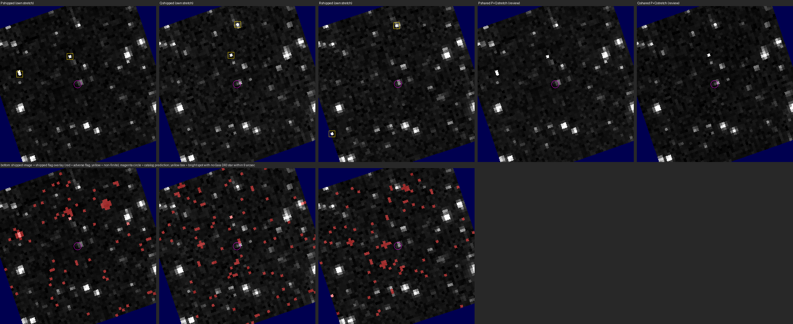

# Draft transfer exercise: "Did anything near WISE 0855 change?"

**Status: DRAFT. Human and science review pending (Sathvik, Sagar).** This is not a shipped case. Nothing under `backend/content/` was changed. The answers below were written by an AI agent from the data. No learner or teacher has tried this exercise yet, so nothing here measures learning.

Prepared 2026-11-15 (UTC) for work packet B5 on branch `claude/b5-contribution-evidence`, from `origin/main` at `9cb850b`.

## Verdict: the retained data supports one sound exercise

This exercise uses a different target, different frames and different traps from the two taught cases:

- **Taught cases:** `fair_comparison` (Epsilon Indi B, A/B/C) and `moving_neighbor` (Barnard's Star, A/B/C).
- **This exercise:** three frames of the WISE 0855 field, already shipped in the `wise_0855` preset. Every frame is a shipped processor-A record. All three are served unchanged by the live release (`GET /api/v1/presets/wise_0855/frames`, checked at 2026-11-15T02:11Z).

The learner must decide what causes each difference: time, wavelength, display stretch or a flagged pixel. Unlike the taught cases, two of the visible differences look like a moving or new object, and **neither is in the sky**.

Two other targets were considered and rejected:

- **R Draconis:** all 35 covered frames are saturated and flagged at the star (BLOOM, OVERFLOW, and mostly non-finite pixels). The only defensible answer would be "cannot tell", so the exercise would test nothing else.
- **RW Aurigae:** 32 of 35 frames are flagged at the target, with only 1 clear frame. There is no clean same-wavelength pair to anchor the reasoning.

## Frames

All three frames are D2 (`spherex_dr1`), on the fixed grid `f448bdf044c35cf1` (6′ field, 256 px, 1.406″/display px, north up). Dates and times come from the IMAGE header `DATE-AVG`/`MJD-AVG`, and match the records.

| Ref | frame_key | Observed (UTC, mid-exposure) | MJD | λ at marker (µm) | Band width (µm) | Quality at marker | Per-frame stretch low–high (MJy/sr) | Raw cutout SHA-256 |
|---|---|---|---|---|---|---|---|---|
| P | `2025W45_2A_0278_1_D2` | 2025-11-07 18:48:11.654 | 60986.783468 | 1.25719 | 0.03005 | clear (0 of 20 screened pixels) | 0.238–2.749 | `fbcca340f53c5652bde70d84c23263219eb22ac0364f02a99a56acd5e26fedd0` |
| Q | `2025W46_1A_0108_1_D2` | 2025-11-10 10:31:39.500 | 60989.438652 | 1.25725 | 0.03005 | flagged: PERSIST (2 of 19) | 0.229–2.250 | `044658e75337cbd35f04b9ba77fa79e9cef96ea7a6489e33f88896506e5cd90f` |
| R | `2026W20_1A_0214_1_D2` | 2026-05-11 13:37:42.970 | 61171.567858 | 1.44425 | 0.03534 | clear (0 of 19) | 0.207–2.229 | `ad926a6715df338cf920660cb81011cbe9456bf68a2c7880ff9be3d776d43388` |

**Source URLs (IRSA):**

- P: <https://irsa.ipac.caltech.edu/ibe/data/spherex/dr1/level2/2025W45_2A/l2b-v27-2026-247/2/level2_2025W45_2A_0278_1D2_spx_l2b-v27-2026-247.fits>
- Q: <https://irsa.ipac.caltech.edu/ibe/data/spherex/dr1/level2/2025W46_1A/l2b-v27-2026-206/2/level2_2025W46_1A_0108_1D2_spx_l2b-v27-2026-206.fits>
- R: <https://irsa.ipac.caltech.edu/ibe/data/spherex/dr1/level2/2026W20_1A/l2b-v27-2026-246/2/level2_2026W20_1A_0214_1D2_spx_l2b-v27-2026-246.fits>

**Provenance:** for each frame, the record's `provenance.sha256`, the `research/build_data/manifest.json` entry and the SHA-256 of the raw file all agree. Re-running processor A (`perigee-processor-a/0.1.2`) on the raw FITS reproduces the following exactly: the wavelength (to 1e-9 µm), the quality block, the display scale, the marker and the **PNG bytes**. See `results.json` → `frames.*.sha256` and `frames.*.reproduced`.

## Measured facts the answer rests on

All values come from `results.json`, generated by `check_transfer.py`.

| Check | P vs Q | P vs R |
|---|---|---|
| **Time apart** | 2.655 days | 184.8 days |
| **Wavelength difference** | 0.00005 µm, 0.002 of the band width. Same detector, and the target falls on the same detector pixel | 0.187 µm, about 6 band widths |
| **WISE 0855 predicted shift** (catalog, not measured) | 0.06″ (0.04 display px) | 4.1″ (2.9 display px), under one 6.17″ native pixel |
| **Display stretch** | Per-frame in both; `high` differs by 18% (2.749 vs 2.250) | Per-frame in both |

### Bright spots

There are 24 bright spot entries across P, Q and R. A spot is a native local maximum that its own frame's stretch draws pure white.

**18 entries are cataloged stars:**
- They are 6 Gaia DR3 stars (from the G < 17 cache), each seen in all three frames.
- Each entry lies within 3.6″ of its Gaia star.

**The other 6 entries have no Gaia DR3 star within 9″.** They are 4 distinct features:

| Where (display px) | What the raw FITS shows | FITS-header flag meaning | In other frames (same sky position, ±9″) |
|---|---|---|---|
| P (114.9, 82.9) and Q (117.9, 80.6) | **One** native pixel: 234.6 (P) and 237.9 (Q) MJy/sr, about 700× its brightest neighbour. It is **the same detector pixel (1709, 1364)** in both frames. Flags: NONFUNC, TRANSIENT, SUR_ERROR. The shipped flag overlay marks it in P and Q. Between P and Q it shifts 3.8 display px (5.3″) while the stars stay put | NONFUNC = "Permanently unusable"; TRANSIENT = "Transient detected during SUR"; SUR_ERROR = "Error in onboard processing" | R: 0.30 MJy/sr (background) |
| P (32.4, 111.8) | 12.6 MJy/sr over two native pixels; not star-shaped. Flags: TRANSIENT, OUTLIER, HALO, SUR_ERROR. Marked by the shipped overlay | OUTLIER = "Pixel flagged by Detect Outliers"; HALO = "Pixel part of a transient halo" | Q and R: 0.29 (background) |
| R (22.4, 209.7) | A single native pixel at the cutout edge, 2.9 MJy/sr. Flags: NONFUNC, TRANSIENT, SUR_ERROR. Marked by the overlay | as above | P: 0.33, Q: 0.30 |
| Q (128.7, 30.4) and R (128.3, 32.3) | 2.2–2.5 MJy/sr in **all three** frames; star-like; no adverse flag | none | P: 2.43 |

The last spot is steady in every frame. It is a sky source missing from the G < 17 Gaia cache, and it is not identified here.

### Near the marker

- **WISE 0855 itself:** at 1.26–1.44 µm it is expected to be far below SPHEREx sensitivity (`science/reviews/targets/README.md` §6). That statement is not re-tested here.
- **The dot closest to the marker is the static Gaia DR3 star `5756956644387831296`** (G 16.3). It is 7.9″ from the marker in P and Q and 4.5″ in R.
- **Q's "flagged" status at the marker** comes from 2 of 19 screened pixels with PERSIST ("Persistent charge above threshold"). It tells you not to trust those pixels. It does not say that something appeared.

### Stretch probe

The same sky value is drawn at different grey levels, because each frame's stretch is computed from that frame alone (`results.json` → `stretch_probe`):

| Sky value (MJy/sr) | Grey in P | Grey in Q | Grey in R |
|---|---|---|---|
| 1.0 | 156 | 174 | 177 |
| 2.0 | 225 | 244 | 245 |

`contact_sheet.png` shows each frame with its own stretch, P and Q on one shared stretch (an illustration for reviewers only), and the shipped flag overlays. Magenta circles mark the catalog prediction; yellow boxes mark the six unmatched spot entries.



## The exercise (learner-facing draft)

**Opening question:** "SPHEREx photographed the sky around the cold brown dwarf WISE 0855 on 7 November 2025 (P), 10 November 2025 (Q) and 11 May 2026 (R). Blink P and Q. One bright dot jumps while the stars stay still, and another dot is only in P. Did something move or appear in the sky? Then decide whether P and R are a fair test of whether WISE 0855 moved."

**Steps:**

1. **Fair pair?** Read each frame's date and its wavelength at the marker. Which pair differs only in time?
2. **Blink P and Q.** Find the dot that jumps, and the dot that is only in P. Turn on **Show flagged pixels**. What covers each one?
3. **Check R.** Is the jumping dot there in R, at the same place among the stars?
4. **Brightness.** Q looks a little brighter overall than P. Is that the sky? (Check how each image was stretched.)
5. **The marker.** Is the dot near the marker WISE 0855?
6. **Claim.** Write a claim, the observations that support it, and the uncertainty. Name what caused each difference: time, wavelength, display stretch or quality.

**Reference answer and rationale** (agent-written, not tested with learners):

- **P/Q is the fair pair for time.** It is 2.7 days apart on the same detector at 1.25719 vs 1.25725 µm, a difference of 0.2% of the band width. Over 2.7 days WISE 0855 is predicted to move only 0.06″, so no motion is expected.
- **The jumping dot is a bad detector pixel, not a mover.**
  - It is one pixel, flagged NONFUNC/TRANSIENT/SUR_ERROR and covered by the red overlay in both P and Q.
  - It is the same detector pixel (1709, 1364) in both frames.
  - It is absent from R.
  - It "moves" 5.3″ because the two pointings differ slightly. Registration lines up the sky, so a defect that is fixed on the detector shifts on the sky grid.
- **The dot only in P is a flagged transient** (TRANSIENT/OUTLIER/HALO/SUR_ERROR). It is not a new object, and it is absent from Q and R.
- **"Q looks brighter" is the display stretch.** Each frame has its own stretch: 1.0 MJy/sr is drawn as grey 156 in P and 174 in Q. Grey levels cannot be compared between these frames, and nothing was measured.
- **The dot near the marker is a cataloged field star** (Gaia DR3 5756956644387831296, 7.9″ away in P and Q). WISE 0855 is not expected to be visible at these wavelengths. Q's PERSIST flag at the marker is a caution about pixels, not a detection.
- **P/R is not a fair test of motion.**
  - It mixes about 185 days with a 0.187 µm wavelength change (about 6 band widths).
  - The predicted 4.1″ shift is under one native pixel.
  - The object itself is not visible.
- **Supported conclusion:** "Nothing in these images shows the sky changing between 7 and 10 November. The jumping dot and the P-only dot are flagged detector problems. The brightness difference is display stretch. These images cannot show whether WISE 0855 moved."
- **Not supported:**
  - "A new object appeared or moved."
  - "WISE 0855 is the dot by the marker."
  - "Q is brighter than P."
  - "P and R show WISE 0855's motion."

## Rubric (draft, 0–2 per row, 12 points)

| Criterion | 2 | 1 | 0 |
|---|---|---|---|
| **Time vs wavelength** | Picks P/Q as the fair pair, citing both the dates and the matched λ | Picks P/Q without the λ evidence | Picks P/R or ignores λ |
| **Jumping dot** | Calls it a flagged detector pixel, citing the overlay or flag and its absence in R | Says "artifact" without evidence | Claims a moving or new object |
| **P-only dot** | Calls it a flagged transient | Says "probably not real" with no check | Calls it a new source |
| **Display stretch** | Says grey levels aren't comparable because the stretch is per-frame | Hedges about brightness without the reason | Claims a brightness change |
| **Marker identity** | Says the nearby dot is not shown to be WISE 0855 (field star, or object too faint here) | Is unsure but makes no claim | Says the dot is WISE 0855 |
| **Claim discipline** | The claim is limited to what the images support, with uncertainty stated (P/R confounded; no measurement) | Partly bounded | Over-claims motion, discovery or brightness |

## Running it in the current app (not verified for this exercise)

The general preset view already has the needed parts:

- **The WISE 0855 preset:** `/?preset=wise_0855`, with all 34 frames.
- **Per-frame date and wavelength labels.**
- **The blink pair picker:** its options show each frame's date and λ (`qa/quality-controls/README.md` §2).
- **The "Show flagged pixels" overlay.**

The learner must pick P, Q and R by date and wavelength. Two other frames share P's and Q's dates (D5 at 4.01 µm), so picking by wavelength is part of the task.

**Not yet checked:**
- This exact path was **not driven in a browser** for this draft.
- The evidence-card export from a non-case preset view was not checked for this exercise.

Making this a guided case would need frontend instructions and science approval. It is out of scope here.

## Reproduce

```sh
.venv/bin/python science/reviews/transfer-exercise/check_transfer.py \
    --data-root "/path/to/research/build_data"
```

The script reads the shipped records, `manifest.json` and the raw FITS (read only), and imports processor A from `backend/data/process.py`. It writes `results.json` and `contact_sheet.png` in this folder. It was run on 2026-11-15 with numpy 2.5.4 and astropy 8.0.2.

## Limitations

- **Not photometry.** Nothing in this exercise is photometry, a detection test or a measured proper motion.
  - The raw values quoted (for example 234.6 MJy/sr) only show that a spot is a single flagged pixel rather than star-shaped.
  - They are not learner-facing brightness claims.
- **Gaia matching is limited.** It uses the cached G < 17 cone (`science/reviews/acceptance/gaia/wise_0855.csv`, radius 0.075°). Fainter or very red sources are absent from it, such as the steady unflagged spot at (128, 31).
- **Flag names are from the pipeline.** The meanings quoted come from each FITS FLAGS header (`MSKD*`). The physical cause of a given NONFUNC or TRANSIENT pixel is not established here.
- **Faintness of WISE 0855 is not re-tested.** It comes from the earlier targets review.
- **P and Q come from different pipeline builds** (`l2b-v27-2026-247` and `-206`), both in DR1.
- **Testing status.** No human has done this exercise. Whether an unfamiliar learner can apply the taught reasoning here is the open question it is meant to test, with Sathvik and Sagar.
